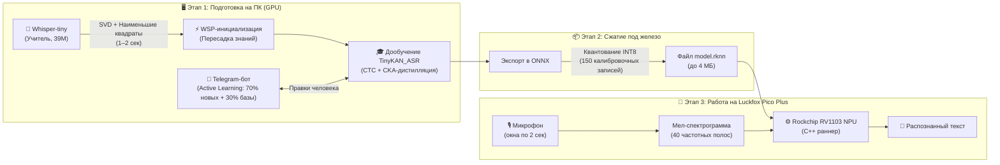
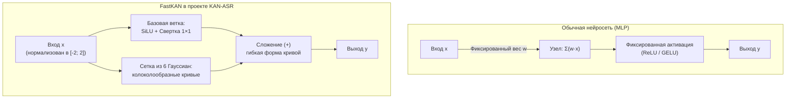
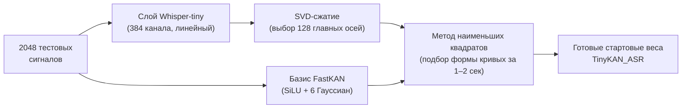
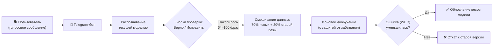
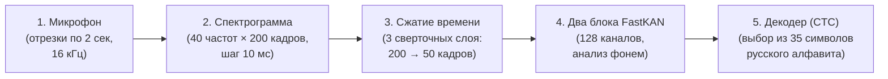

# Нейросеть на спичечном коробке: как «пересадить мозг» Whisper в крошечный микрокомпьютер

Распознавание речи обычно ассоциируется с мощными облачными серверами или тяжелыми моделями вроде Whisper от OpenAI, которым подавай гигабайты видеопамяти. Но что, если нужно, чтобы устройство понимало человеческую речь **полностью автономно, без интернета** и на плате размером с половину кредитной карты?

Именно такую задачу решает проект **KAN-ASR**. Его цель — научить бюджетный одноплатный компьютер **Luckfox Pico Plus** (на базе чипа Rockchip RV1103) распознавать русскую речь в реальном времени.

---

## 📊 Инфографика: Whisper-tiny против TinyKAN_ASR

| Параметр | Учитель: Whisper-tiny (OpenAI) | Ученик: TinyKAN_ASR (Luckfox) | Выигрыш / Особенность |
| :--- | :--- | :--- | :--- |
| **Количество параметров** | ~39 000 000 (39M) | **~1 200 000 (1.2M)** | **В 32 раза компактнее** |
| **Размер модели в памяти** | ~150 МБ (FP32) | **1.5 – 4 МБ (INT8)** | Помещается в кэш/RAM чипа |
| **Требования к ОЗУ (RAM)** | От 1–2 ГБ и выше | **8 – 10 МБ** (из 64 МБ на плате) | Работает без ОС с тяжелым Python |
| **Временной шаг анализа** | 20 мс (50 кадров/сек) | **40 мс** (25 кадров/сек) | В 2 раза меньше вычислений |
| **Внутренняя размерность** | 384 канала | **128 каналов** | Сжатие через SVD-проекцию |
| **Тип нелинейности** | Классический MLP (GELU) | **FastKAN (SiLU + 6 Гауссиан)** | Аппаратно дружелюбно для NPU |
| **Среда выполнения** | Python / PyTorch / GPU | **Чистый C++ + NPU (0.5 TOPS)** | Полный офлайн в реальном времени |

---

## 🗺 Общая схема работы системы (от обучения до микрочипа)

---

## Шаг 1. Меняем архитектуру: умные связи вместо умных нейронов

Обычные нейросети (многослойные перцептроны) устроены как конвейер: нейроны просто умножают входные числа на фиксированные веса, складывают их и пропускают через простую функцию активации. Чтобы сеть хорошо понимала речь, таких нейронов нужны десятки миллионов.

В основе KAN-ASR лежит относительно новая архитектура — **сети Колмогорова–Арнольда (KAN)**. В них всё перевернуто с ног на голову: вместо того чтобы усложнять узлы сети, «умными» делают сами связи между ними. Каждая связь подбирает собственную гибкую математическую кривую, которая подстраивается под сигнал. Благодаря этому сеть становится в разы компактнее при сопоставимой точности — в итоговой модели **TinyKAN_ASR всего 1,2 миллиона параметров**.

### Схема архитектуры: чем классическая сеть отличается от FastKAN

**Инженерная хитрость:** В классических KAN для построения кривых используют сложные B-сплайны, на которых слабый процессор микрокомпьютера просто «захлебнулся» бы. Поэтому в проекте используется версия **FastKAN**: сложные сплайны заменили на набор из 6 простых колоколообразных функций (Гауссиан). Их можно считать с помощью базовых математических операций — вычитания, возведения в квадрат и экспоненты, которые аппаратный нейроускоритель (NPU) чипа умеет щелкать за доли миллисекунды.

---

## Шаг 2. «Пересадка мозга» вместо зубрежки с нуля

Обучить крошечную нейросеть понимать речь с чистого листа — задача почти невыполнимая: ей просто не хватит «кругозора», чтобы выучить все оттенки фонем и интонаций.

Чтобы не учить модель с нуля, в проекте применяется техника **Weight-Space Programming (WSP)** — программирование в пространстве весов. В роли «донора знаний» выступает предобученная модель **Whisper-tiny** от OpenAI. Перенос опыта проходит в два этапа:

1. **Сжатие слуха (SVD-проекция).** Входной слой Whisper умеет мастерски выделять в звуке гласные и согласные (форманты). С помощью матричного разложения (SVD) алгоритм выжимает из 384 каналов «учителя» 64 самых главных детектора звуков и записывает их напрямую в первый слой маленькой модели.
2. **Перевод с языка обычных сетей на язык KAN.** Внутри Whisper работают стандартные линейные слои. Скрипт инициализации пропускает через них тысячи тестовых сигналов, смотрит, как реагирует Whisper, и математически (методом наименьших квадратов) подбирает форму «колоколов» в FastKAN так, чтобы маленькая сеть повторяла поведение большой.

Вся «операция по пересадке» занимает всего **1–2 секунды** на обычной видеокарте. В результате сеть начинает свое обучение не как младенец, а как подготовленный студент.

---

## Шаг 3. Обучение с наставником и защита от «округления»

После пересадки весов модель нужно доучить под русский алфавит. Здесь включается режим дистилляции (**CKA Alignment**): большая модель Whisper присматривает за маленькой во время обучения и следит, чтобы их внутреннее «восприятие» похожих звуков совпадало. Причем поскольку Whisper анализирует звук шагами по **20 миллисекунд**, а компактная модель ради экономии памяти — шагами по **40 миллисекунд**, алгоритм автоматически склеивает каждые два шага учителя в один, синхронизируя их ритм.

Но есть еще одна ловушка. Чтобы модель поместилась в память чипа и работала быстро, её нельзя запускать в обычных дробных числах — её нужно сжать до целых 8-битных чисел (**INT8**), где на любое значение есть всего **256 градаций**.

* **Опасность выбросов:** Если внутри нейросети возникнет хотя бы один резкий скачок значений, при сжатии в INT8 все остальные тихие звуки речи «сплющатся» в ноль, и модель оглохнет.
* **Двойная защита:** При обучении используется специальный математический «якорь» (L2-регуляризация), который не дает весам далеко убегать от безопасных значений, а нормализация удерживает сигналы в строгом рабочем коридоре от `-2.0` до `2.0`.

---

## Шаг 4. Самообучение через Telegram (Active Learning)

Акустические модели часто «плывут» в реальной жизни: мешает эхо комнаты, дешевый микрофон или особенности дикции конкретного человека. Чтобы решить эту проблему без ручной пересборки датасетов, в проект встроен контур живого дообучения через Telegram-бота:

Чтобы модель не забыла весь русский язык, пытаясь угодить вашим последним десяти фразам (эффект катастрофического забывания), она учится на коктейле: **70% новых записей и 30% старой базовой базы**. А новые веса принимаются только в том случае, если процент ошибок на контрольном тесте реально снизился.

---

## Финал: как аудио превращается в текст на чипе Luckfox

Когда модель готова, она экспортируется в формат **RKNN** и загружается на плату Luckfox Pico Plus. Никакого тяжелого Python там уже нет — работает только компактная программа на C++:

1. **Микрофон** захватывает звук окнами по 2 секунды.
2. **Быстрое преобразование Фурье** нарезает звук в спектрограмму (картинку из 40 частотных полос).
3. **Нейроускоритель NPU** сжимает время в 4 раза и прогоняет картинку через два блока FastKAN за считанные миллисекунды.
4. **Простой декодер (Greedy CTC)** убирает повторы и паузы, склеивая распознанные буквы в слова.

Этот проект — отличный пример того, как современные математические идеи из научных статей (KAN-сети и перенос знаний в пространстве весов) можно приземлить на реальное, сверхбюджетное железо, заставив копеечный микроконтроллер слышать и понимать речь без подключения к облаку.
