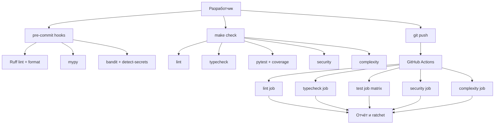

# План: современный контур качества кода для KAN-ASR

> **Статус:** черновик на согласование.
> **Режим внедрения:** GitHub Actions + мягкий старт (baseline-исключения и
> постепенное ужесточение), плюс локальные pre-commit-хуки и цели Makefile.

## 1. Цель

Включить полный современный набор проверок качества для Python-проекта
(линтеры, форматтер, типизация, тесты с покрытием, безопасность, сложность,
гигиена коммитов) так, чтобы:

1. проверки запускались **локально** (pre-commit + `make`) и **в CI** (GitHub Actions);
2. внедрение **не ломало текущий код** — стартуем с baseline-исключений и
   «ratchet»-процесса (постепенное ужесточение);
3. конфигурация была **единой точкой правды** в `pyproject.toml` там, где это возможно.

## 2. Текущее состояние (аудит)

| Область | Что есть | Чего нет |
|---|---|---|
| Линт/формат | секция `[tool.ruff]` в [`pyproject.toml`](../pyproject.toml:71) (только `line-length`, `target-version`) | набор правил, форматтер, isort-профиль |
| Типы | секция `[tool.mypy]` (2 флага) | строгость, overrides, второй чекер |
| Тесты | 12 файлов в [`tests/`](../tests/conftest.py:1), метки `recognition`/`hardware` | coverage, xdist, timeout, gate |
| Безопасность | — | bandit, pip-audit, secret-scan |
| Сложность | — | radon/xenon, vulture, interrogate |
| Pre-commit | `pre-commit` в [`requirements-dev.txt`](../requirements-dev.txt:6) | `.pre-commit-config.yaml` |
| CI | — | `.github/workflows/`, dependabot |
| Makefile | цели `test`, `test-recognition`, `test-hardware` | `lint`, `format`, `typecheck`, `security`, `check` |
| Гигиена коммитов | — | commitizen / conventional commits |

### Замечания, которые надо учесть до включения CI

1. **Баг в [`.gitignore`](../.gitignore:8): паттерн `data/` матчит любой каталог
   `data` на любой глубине** — в том числе `src/kan_asr/data/` с Python-кодом
   ([`mel.py`](../src/kan_asr/data/mel.py:13), [`vocab.py`](../src/kan_asr/data/vocab.py:7),
   [`dataset.py`](../src/kan_asr/data/dataset.py:19), `augment.py`, `generate.py`).
   Из-за этого код пакета не попадает в git. **Фикс:** анкорить к корню —
   `/data/`, `/artifacts/`, `/cache/`, `/logs/` (и проверить `*.onnx`/`*.pt`:
   они тоже матчат вложенные файлы, что для артефактов ок, но стоит осознать).
2. **Дублирование логики:** `greedy_ctc_decode` определён и в
   [`data/vocab.py`](../src/kan_asr/data/vocab.py:17), и в
   [`training/ctc.py`](../src/kan_asr/training/ctc.py:12) — кандидат на
   консолидацию (ruff `F811`/`vulture` подсветят).
3. **Ленивый импорт `torch`** в [`data/vocab.py`](../src/kan_asr/data/vocab.py:17)
   со строковой аннотацией `"torch.Tensor"` и `# type: ignore` — потребует
   `overrides`/`ignore_missing_imports` в mypy.
4. **Мусор в корне:** `check0_base_optimize.onnx`, `check1_fold_constant.onnx`,
   `check2_correct_ops.onnx`, `check3_fuse_ops.onnx` — покрыты `.gitignore`
   (`*.onnx`), но лежат в рабочем дереве и мешают `check-added-large-files`.

## 3. Целевой набор инструментов

### 3.1 Линт и форматирование — Ruff (единый инструмент)

Ruff заменяет black, isort, flake8 (+плагины), pyupgrade, pydocstyle, bandit (частично).
Набор правил (мягкий старт — включаем широко, шумное глушим через `ignore`/`per-file-ignores`):

- `E`, `W` — pycodestyle
- `F` — pyflakes
- `I` — isort
- `N` — pep8-naming
- `UP` — pyupgrade
- `B` — flake8-bugbear
- `C4` — flake8-comprehensions
- `SIM` — flake8-simplify
- `PT` — flake8-pytest-style
- `RUF` — ruff-specific
- `S` — flake8-bandit (security)
- `D` — pydocstyle (docstrings; на старте — только `D1`/`D2` в режиме отчёта)
- `ANN` — flake8-annotations (на старте — отключено, включаем позже)
- `T20` — flake8-print (для `src/`, в `scripts/` разрешён)
- `ERA` — eradicate (закомментированный код)
- `PL` — pylint-подмножество (осторожно, шумно)

Форматтер: `ruff format` (замена black). Профиль isort: `known-first-party = ["kan_asr"]`.

### 3.2 Типизация — mypy (+ опционально pyright)

- `mypy` в режиме постепенного ужесточения: `warn_unused_ignores`,
  `warn_redundant_casts`, `no_implicit_optional`, `check_untyped_defs`,
  `disallow_untyped_defs` — включаем **по модулям** через `[[tool.mypy.overrides]]`.
- `ignore_missing_imports` для `torch`, `rknn`, `piper`, `onnxruntime`.
- Опционально `pyright` как второй чекер (в CI — отдельная джоба, `continue-on-error`).

### 3.3 Тесты и покрытие

- `pytest` + `pytest-cov` (покрытие, `--cov-fail-under` стартует с baseline),
  `pytest-xdist` (параллельно), `pytest-timeout` (защита от зависаний),
  `pytest-randomly` (порядок), `pytest-sugar` (UX).
- Разделение прогонов: быстрый `-m "not recognition and not hardware"` в CI,
  тяжёлые метки — отдельно/по требованию.
- `coverage` конфиг в `pyproject.toml` (`[tool.coverage.*]`), `branch = true`.

### 3.4 Безопасность

- `bandit` (или ruff-правила `S`) — статический анализ.
- `pip-audit` — уязвимости в зависимостях.
- `detect-secrets` (Yelp) с `.secrets.baseline` — сканирование секретов.
- Опционально `gitleaks` в CI.

### 3.5 Сложность и мейнтейнабилити

- `radon` (cc, mi) — отчёт.
- `xenon` — gate по цикломатической сложности (мягкий порог на старте).
- `vulture` — мёртвый код (отчёт, baseline whitelist).
- `interrogate` — покрытие docstring (мягкий порог).

### 3.6 Гигиена коммитов

- `commitizen` — conventional commits + `cz bump` (опционально).
- Хуки `pre-commit-hooks`: `trailing-whitespace`, `end-of-file-fixer`,
  `check-yaml`, `check-toml`, `check-added-large-files`, `check-merge-conflict`,
  `mixed-line-ending`, `check-ast`.

### 3.7 C++/CUDA (ВНЕ текущего захода)

- `clang-format` + `clang-tidy` для [`csrc/`](../csrc/setup.py:1) и [`edge/`](../edge/CMakeLists.txt:1).
- `cmake-format` для `CMakeLists.txt`.
- **Решение:** вынести в один из следующих заходов, сейчас не трогаем.

## 4. Фазы внедрения

### Фаза 0 — Снятие блокеров
- Исправить [`.gitignore`](../.gitignore:8): анкорить `data/`, `artifacts/`,
  `cache/`, `logs/` к корню (`/data/` и т.д.), чтобы `src/kan_asr/data/` с кодом
  не игнорировался. Проверить `git status`, что код пакета виден.
- Убедиться, что `pytest tests/ -m "not recognition and not hardware"` проходит.
- Убрать мусорные `check*.onnx` из корня.
- (Опционально) консолидировать дублирующийся `greedy_ctc_decode`.

### Фаза 1 — Конфигурационная основа
- Расширить [`pyproject.toml`](../pyproject.toml:1): `[tool.ruff]` (+`lint`/`format`),
  `[tool.mypy]` (+overrides), `[tool.pytest.ini_options]` (+addopts),
  `[tool.coverage.*]`, `[tool.bandit]`, `[tool.interrogate]`.
- Добавить `.editorconfig`, `.gitattributes`.

### Фаза 2 — Pre-commit
- `.pre-commit-config.yaml` (ruff, ruff-format, mypy, bandit, detect-secrets,
  базовые хуки, commitizen).
- `.secrets.baseline`.
- Секция `[tool.commitizen]` в `pyproject.toml`.

### Фаза 3 — Makefile
- Новые цели: `lint`, `format`, `typecheck`, `security`, `complexity`,
  `test-cov`, `pre-commit`, `check` (всё сразу), `ci`.
- Обновить `help` и `.PHONY`.

### Фаза 4 — CI (GitHub Actions)
- `.github/workflows/ci.yml`: матрица Python 3.10/3.11/3.12; джобы
  `lint`, `typecheck`, `test` (с coverage), `security`, `complexity`.
- Кэширование pip, `concurrency` (отмена устаревших прогонов).
- **Мягкий старт:** строгие джобы с `continue-on-error: true` + сводка-отчёт;
  переключение в блокирующий режим — по мере ratchet.
- `.github/dependabot.yml` (pip + github-actions).
- Опционально `codecov.yml`.

### Фаза 5 — Baseline и ratchet
- Зафиксировать baseline: `# noqa`/`per-file-ignores` для ruff, `overrides` для
  mypy, `--cov-fail-under` = текущее покрытие, пороги xenon/interrogate.
- Документировать процесс ужесточения (что и когда включаем).

### Фаза 6 — Документация
- `CONTRIBUTING.md` и/или `docs/quality.md`: как запускать проверки локально,
  что делает CI, как обновлять baseline.
- Обновить [`README.md`](../README.md:1) (раздел «Разработка»).

## 5. Схема контура

## 6. Принципы мягкого старта

1. **Ничего не блокируем сразу.** Строгие проверки в CI идут с
   `continue-on-error: true`; локально — предупреждения, не падения.
2. **Baseline вместо отключения.** Шумные правила не выключаем глобально, а
   глушим точечно (`per-file-ignores`, `# noqa`, `overrides`), чтобы видеть прогресс.
3. **Ratchet.** Периодически повышаем пороги (coverage, xenon, docstring) и
   снимаем исключения; фиксируем в `docs/quality.md`.
4. **Разделение по зонам.** `src/` — строже; `scripts/`, `tests/` — мягче
   (разрешены `print`, `assert`, отсутствие аннотаций).
5. **Быстрый локальный цикл.** `make check` не тянет тяжёлые `recognition`/`hardware`
   тесты и не требует `rknn-toolkit2`.

## 7. Принятые решения по открытым вопросам

- **C++/CUDA-линтеры** (clang-format/clang-tidy, cmake-format) — **вне текущего
  захода**, вынести в один из следующих.
- **`pyright`** — не включаем сейчас; оставляем `mypy`. Вернуться позже при
  необходимости (в CI можно добавить необязательной джобой).
- **`commitizen`/conventional commits** — не делаем обязательным gate; можно
  добавить как необязательный хук позже.
- **`greedy_ctc_decode` (два определения)** — отложить, но **не забыть**.
  Зафиксировано в бэклоге (раздел 8).

## 8. Бэклог (не забыть)

- [ ] Консолидировать дублирующийся `greedy_ctc_decode`
  ([`data/vocab.py`](../src/kan_asr/data/vocab.py:17) и
  [`training/ctc.py`](../src/kan_asr/training/ctc.py:12)) — оставить одну
  реализацию, вторую импортировать.
- [ ] C++/CUDA-линтеры (clang-format/clang-tidy, cmake-format) — следующий заход.
- [ ] Оценить `pyright` как второй чекер типов.
- [ ] Оценить `commitizen`/conventional commits.
