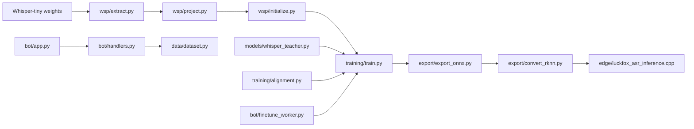

# План реализации раздела 3.1 (в порядке приоритетов)

> Источник: [`plans/migration_audit.md`](plans/migration_audit.md:115) (v2), раздел 3.1.
> Порядок: 🔴 функциональные разрывы → 🟡 дефекты → 🟢 документация → 🟡 инфраструктура → 🔴 верификация.
> Режим реализации: Code.

---

## Этап A. 🔴 Функциональные разрывы контура

### A1. Связать WSP → обучение (`--wsp-checkpoint`)

**Файлы:** [`src/kan_asr/training/train.py`](src/kan_asr/training/train.py:23), [`scripts/train.py`](scripts/train.py:23), [`scripts/wsp_init.py`](scripts/wsp_init.py:25)

- В `train()` добавить параметр `wsp_checkpoint: str = None`.
- После `model = TinyKAN_ASR().to(device)` — если `wsp_checkpoint` задан и существует, загрузить `state_dict` (`strict=True`), залогировать `[WSP] Загружена инициализация: ...`; иначе — предупреждение о случайной инициализации.
- В `scripts/train.py` добавить `--wsp-checkpoint` и прокинуть в `train()`.
- В `scripts/wsp_init.py` сменить дефолт `--output` на `artifacts/checkpoints/tiny_kan_wsp_initialized.pt` (согласовать с [`docs/wsp.md`](docs/wsp.md:47)) и создавать каталог через `os.makedirs`.

**Критерий:** `python scripts/train.py --wsp-checkpoint artifacts/checkpoints/tiny_kan_wsp_initialized.pt` загружает веса до старта эпох.

### A2. Встроить CKA-выравнивание в цикл обучения

**Файлы:** [`src/kan_asr/training/train.py`](src/kan_asr/training/train.py:23), [`scripts/train.py`](scripts/train.py:23)

- Добавить параметры: `use_alignment: bool = False`, `align_weight: float = 0.3`, `whisper_state: str = None`, `teacher_device: str = None`.
- При `use_alignment`:
  - создать `WhisperTinyTeacher()`; если `whisper_state` задан — `load_hf_weights(...)`, иначе предупреждение и отключение alignment;
  - создать `WhisperKANAlignmentLoss(student_dim=128, teacher_dim=384, anchor_weight=1e-3)`;
  - вызвать `register_wsp_anchors(model)` **после** загрузки WSP-чекпоинта (A1) — якорь фиксирует стартовые веса KAN;
  - добавить параметры `align_criterion` в `optimizer`;
  - создать второй mel-экстрактор `PureMelSpectrogram(n_mels=80)` для учителя (вход `[B, 80, T]`).
- В цикле: `logits, h1, h2 = model(mels, return_features=True)`; `t_feats = teacher.forward_features(mel80)`; `align = align_criterion(h1, h2, t_feats["block_1"], t_feats["final"], student_model=model)`; `loss = ctc + align_weight * align["total_align"]`.
- Логировать `CTC / CKA / Cosine` по эпохе.
- В `scripts/train.py` добавить `--align`, `--align-weight`, `--whisper-state`.

**Критерий:** при `--align --whisper-state <path>` лосс содержит компоненту выравнивания; без весов — graceful skip.

### A3. Завершить бот: текстовые ответы → `confirm_sample`

**Файлы:** [`src/kan_asr/bot/app.py`](src/kan_asr/bot/app.py:45)

- Добавить `self.pending: dict[int, str] = {}` (user_id → filename последнего сэмпла).
- В `_handle_update`: если `message.get("text")` и для `user_id` есть pending — вызвать [`handlers.confirm_sample`](src/kan_asr/bot/handlers.py:51), очистить pending, ответить подтверждением.
- Обработать `/start` (приветствие) и неизвестные тексты без pending.

**Критерий:** после голосового сообщения текстовый ответ пользователя создаёт запись в `data/real/metadata.csv`.

### A4. Завершить бот: конвертация ogg→wav

**Файлы:** [`src/kan_asr/bot/handlers.py`](src/kan_asr/bot/handlers.py:36)

- Добавить `_convert_ogg_to_wav(ogg_path, wav_path)` через `ffmpeg-python` (16 кГц, моно, PCM s16le).
- `save_voice_sample` сохраняет `.ogg` во временный файл, конвертирует в `data/real/wavs/user{id}_{msg}.wav`, удаляет `.ogg`, возвращает `wavs/...wav`.
- Обработать отсутствие ffmpeg (лог + понятная ошибка).

**Критерий:** [`ASRDataset`](src/kan_asr/data/dataset.py:36) читает сохранённые сэмплы через `scipy.io.wavfile` без ошибок.

### A5. Завершить бот: триггер `run_finetune` по порогу

**Файлы:** [`src/kan_asr/bot/app.py`](src/kan_asr/bot/app.py:45), [`src/kan_asr/bot/finetune_worker.py`](src/kan_asr/bot/finetune_worker.py:83)

- Ввести константу `FINETUNE_THRESHOLD` (напр. 20) и счётчик подтверждённых сэмплов.
- После `confirm_sample` при достижении порога — запустить `run_finetune` в фоне через `asyncio.to_thread` (не блокировать polling), сбросить счётчик.

**Критерий:** накопление N подтверждённых пар инициирует дообучение без остановки бота.

### A6. Подключить `WeightSpaceHyperAdapter` в `finetune_worker.py`

**Файлы:** [`src/kan_asr/bot/finetune_worker.py`](src/kan_asr/bot/finetune_worker.py:83), [`src/kan_asr/wsp/hyper_adapter.py`](src/kan_asr/wsp/hyper_adapter.py:12)

- Добавить `run_finetune(..., use_hyper_adapter: bool = False)`.
- При `use_hyper_adapter`: создать `WeightSpaceHyperAdapter(model)`, обучать **только** параметры адаптера (заморозить модель), применять `get_delta_weights()` к `kan1.rbf_conv` / `kan2.rbf_conv` на каждом шаге.
- Сохранять чекпоинт с учётом поправок.

**Критерий:** дообучение через адаптер не изменяет базовые веса напрямую; поправки применяются к KAN-слоям.

---

## Этап B. 🟡 Дефекты и синхронизация

### B1. `data/calib/calib_dataset.txt`
Перегенерировать пути: `data/calib/calib_000.npy` … `calib_019.npy` (относительно корня проекта).

### B2. Синхронизация `configs/*.yaml` с кодом
- [`configs/model.yaml`](configs/model.yaml:42): `opset: 12` → `13` (согласовать с [`export_onnx.py`](src/kan_asr/export/export_onnx.py:19)).
- [`configs/wsp.yaml`](configs/wsp.yaml:14): `ridge_alpha: 1.0e-6` → `1.0e-2` (согласовать с [`project.py`](src/kan_asr/wsp/project.py:98)).
- [`configs/wsp.yaml`](configs/wsp.yaml:15): `block_indices: [1, 3]` → `[0, 3]` (согласовать с [`initialize.py`](src/kan_asr/wsp/initialize.py:54)).
- [`configs/wsp.yaml`](configs/wsp.yaml:19): `whisper_state_dict` → `artifacts/checkpoints/whisper_tiny.pt`.
- [`configs/train.yaml`](configs/train.yaml:25): `alignment.enabled: true` — оставить, после A2 станет валидным.

### B3. Загрузчик конфигов
Создать [`src/kan_asr/utils/config.py`](src/kan_asr/utils/config.py:1) с `load_config(name)` (yaml + `resolver.configs`), прокинуть в `scripts/*` (опционально, с приоритетом CLI-аргументов).

### B4. `convert_rknn.py`: `os.makedirs`
Добавить `os.makedirs(os.path.dirname(rknn_model), exist_ok=True)` перед `export_rknn` ([`convert_rknn.py`](src/kan_asr/export/convert_rknn.py:25)).

### B5. `build_mixed_dataset`
`_read_meta` возвращает `(rel, text, root)`; копирование из корректного `root` без хрупкой проверки `(rel, text) in new_rows` ([`finetune_worker.py`](src/kan_asr/bot/finetune_worker.py:72)).

### B6. `scripts/run_bot.py`
Убрать неиспользуемые `--chat-id`; `--model` либо задействовать (передать в бот), либо удалить ([`run_bot.py`](scripts/run_bot.py:28)).

### B7. `autocast` на CPU
`torch.amp.autocast(device_type=device.type, enabled=use_bf16, dtype=torch.bfloat16)` ([`train.py`](src/kan_asr/training/train.py:87)).

---

## Этап C. 🟢 Документация

- C1. Обновить [`docs/setup.md`](docs/setup.md:1): убрать `./piper/`, `dataset_synth`, номера строк; исправить `pip install pip`.
- C2. Привести [`docs/wsp.md`](docs/wsp.md:1) в соответствие с [`scripts/wsp_init.py`](scripts/wsp_init.py:25) (путь вывода, автозагрузка весов).
- C3. Перенести README: `FastKAN_CUDA_Kernel/README_CUDA.md` → `csrc/README.md`; `Whisper_CKA_Alignment/README_ALIGNMENT.md`; `KAN_ASR_Pipeline_Bundle/README.md`.
- C4. Перенести `FastKAN_CUDA_Kernel/test_and_benchmark.py` → `csrc/` или `tests/`.
- C5. Оставить MD-версии доков; PDF-дубликаты — в список удаления (раздел 3.2).

---

## Этап D. 🟡 Инфраструктура

- D1. Вынести `rknn-toolkit2` и `piper-tts` в `[project.optional-dependencies]` (`rknn`, `tts`); убрать из базовых `dependencies` ([`pyproject.toml`](pyproject.toml:35), [`requirements.txt`](requirements.txt:10)).
- D2. Расширить [`.gitignore`](.gitignore:1): `*.egg-info/`, `build/`, `dist/`, `.pytest_cache/`, `.ruff_cache/`, `.mypy_cache/`.
- D3. Удалить/перегенерировать `kan_asr.egg-info/`.

---

## Этап E. 🔴 Верификация

- E1. `pip install -e .` в venv; `python -c "import kan_asr"`.
- E2. `pytest tests/ -v` (все тесты).
- E3. `python scripts/*.py --help` из корня.
- E4. End-to-end: `wsp_init` → `train` (с `--wsp-checkpoint` и `--align`) → `export_onnx` → `convert_rknn`.

---

## Диаграмма целевого контура

Все стрелки — сплошные: контур замкнут.
