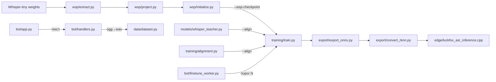

# Повторный аудит структуры после миграции (v2)

> Задача: проверить, что было сделано по [`plans/migration_audit.md`](plans/migration_audit.md:1) (v1),
> и составить актуальные списки «доделать» / «удалить».
> Дата: 2026-11-15. Режим: Architect.

## 0. Метод проверки

- Рекурсивный обход `list_files` по корню, `src/kan_asr`, `data`, `artifacts`, `docs`, `csrc`, `edge`, `configs`, `tests`, `scripts`.
- Чтение фактического содержимого ключевых модулей (`read_file`) и сверка с легаси-источниками в `KAN_ASR_Pipeline_Bundle/`, `Whisper_CKA_Alignment/`, `FastKAN_CUDA_Kernel/`.
- Поиск остаточных ссылок (`search_files`) на `from src.`, `dataset_synth`, `calib_npy`, `./piper`.
- Сверка с планом [`plans/project_structure_migration.md`](plans/project_structure_migration.md:1).

---

## 1. Что закрыто с прошлого аудита (v1 → v2)

### 1.1 Восстановленные модули (раздел 2 v1) — ✅ ВЫПОЛНЕНО

| # | Пункт v1 | Факт |
|---|----------|------|
| 1 | `src/kan_asr/data/` (`mel.py`, `vocab.py`, `__init__.py`) | ✅ + `augment.py`, `generate.py`, `dataset.py` |
| 2 | `src/kan_asr/export/export_onnx.py` | ✅ |
| 3 | `src/kan_asr/export/convert_rknn.py` | ✅ |
| 4 | `src/kan_asr/training/train.py` | ✅ |
| 5 | `src/kan_asr/training/ctc.py`, `metrics.py` | ✅ |
| 6 | `src/kan_asr/data/generate.py`, `augment.py`, `dataset.py` | ✅ |
| 7 | `src/kan_asr/bot/app.py`, `handlers.py`, `finetune_worker.py` | ✅ (см. п. 2.2 — функционально неполны) |
| 8 | `src/kan_asr/models/cuda_fastkan.py` | ✅ |
| 9 | `configs/*.yaml` | ✅ заполнены (`model`, `wsp`, `train`, `bot`) |
| 10 | `csrc/*` | ✅ `fastkan_kernel.cu`, `fastkan_kernel.h`, `bindings.cpp`, `setup.py` |
| 11 | `edge/*` | ✅ `luckfox_asr_inference.cpp`, `CMakeLists.txt`, `README.md` |
| 12 | `docs/wsp.md`, `docs/architecture.md` | ✅ |
| 13 | `tests/test_kan_layers.py`, `test_wsp.py`, `test_mel.py`, `test_ctc.py` | ✅ + `test_piper_tts.py` |

### 1.2 Дефекты (раздел 4 v1) — ✅ ВЫПОЛНЕНО

1. **Архитектура `TinyKAN_ASR` синхронизирована.** [`models/tiny_kan_asr.py`](src/kan_asr/models/tiny_kan_asr.py:99) теперь канонический источник: encoder 3× `DepthwiseSeparableConv1D_as_2D` → 2× `FastKANConv1x1` (residual + BN) → `Conv2d` head. Совпадает с WSP-ожиданиями (`dw/pw`, `kan1/kan2`, `grid/denom/base_conv/rbf_conv`).
2. **Дублирование `extract_conv_subspace` убрано.** [`wsp/initialize.py`](src/kan_asr/wsp/initialize.py:13) — тонкая обёртка над [`wsp/extract.py`](src/kan_asr/wsp/extract.py:33).
3. **API `wsp/project.py` выровнен** под `grid/denom/base_conv/rbf_conv` ([`project.py`](src/kan_asr/wsp/project.py:21)).
4. **Импорты `from src.kan_asr...` устранены** — в `scripts/*` и `tests/*` используется `from kan_asr...` с bootstrap-фолбэком.
5. **`pyproject.toml` исправлен:** `where = ["src", "."]`, `include = ["kan_asr*", "scripts*"]` ([`pyproject.toml`](pyproject.toml:54)).
6. **Ожидание формы mel в smoke-тесте поправлено** на `(1, 40, 1, 101)` ([`tests/test_smoke.py`](tests/test_smoke.py:33)).
7. **`whisper_teacher.load_hf_weights` реализован** (маппинг HF-ключей) ([`whisper_teacher.py`](src/kan_asr/models/whisper_teacher.py:67)).
8. **`training/alignment.py` перенесён** ([`alignment.py`](src/kan_asr/training/alignment.py:12)).

**Вывод:** физический перенос кода/данных/артефактов/доков завершён; критический блокер v1 (отсутствие `data/`) снят.

---

## 2. Что осталось сделать

### 2.1 Удаление легаси (раздел 3 v1) — ✅ ВЫПОЛНЕНО

> **Статус (обновлено):** все перечисленные ниже легаси-файлы, каталоги, пустые
> каталоги-«скобки», `kan_asr.egg-info/` и PDF-дубликаты доков **удалены**.
> Содержимое перенесено в `src/`/`csrc/`/`edge/`, zip-копии — в `archive/`.

Ранее присутствовали в корне:

- **Легаси-файлы:** [`kan_asr_models.py`](kan_asr_models.py:1), [`whisper_wsp_initializer.py`](whisper_wsp_initializer.py:1), [`run_wsp_demo.py`](run_wsp_demo.py:1), [`test_piper_tts.py`](test_piper_tts.py:1), [`README_WSP.md`](README_WSP.md:1).
- **Легаси-каталоги:** `FastKAN_CUDA_Kernel/`, `KAN_ASR_Pipeline_Bundle/`, `Whisper_CKA_Alignment/`.
- **Пустые каталоги-«скобки»** (артефакт неразвёрнутого brace-expansion, реальные каталоги с `{}` в имени):
  - `src/kan_asr/{models,wsp,data,training,export,bot,utils}/`
  - `data/{synth,calib,samples,raw,real}/`
  - `artifacts/{piper,onnx,rknn,checkpoints}/`
  - `docs/{chats}/`
- **Устаревший build-артефакт:** `kan_asr.egg-info/` (SOURCES.txt не содержит `data/augment.py`, `dataset.py`, `generate.py`, `ctc.py`, `metrics.py`, `cuda_fastkan.py`, `logging.py`, `bot/app.py` и др. — устарел).

> Удалять легаси можно: содержимое уже перенесено в `src/`/`csrc/`/`edge/`, zip-копии лежат в `archive/`.

### 2.2 Функциональные пробелы (код есть, но контур не связан)

1. **WSP → обучение не соединены.** [`training/train.py`](src/kan_asr/training/train.py:57) создаёт `TinyKAN_ASR()` со случайной инициализацией и **не загружает** WSP-чекпоинт. [`scripts/train.py`](scripts/train.py:23) не имеет опции `--wsp-checkpoint`. Ключевая идея проекта (инициализация из Whisper) в пайплайне отсутствует.
2. **CKA-выравнивание не в цикле обучения.** [`WhisperKANAlignmentLoss`](src/kan_asr/training/alignment.py:38) и [`WhisperTinyTeacher`](src/kan_asr/models/whisper_teacher.py:52) определены, но нигде не вызываются. Легаси-демо [`train_with_alignment.py`](Whisper_CKA_Alignment/train_with_alignment.py:68) (CTC + 0.3·align) не перенесён в `training/train.py`.
3. **`WeightSpaceHyperAdapter` не используется** — нет интеграции в `finetune_worker.py`.
4. **Бот не завершён (Human-in-the-Loop):**
   - [`bot/app.py`](src/kan_asr/bot/app.py:45) обрабатывает только `voice`; ответ пользователя текстом (подтверждение/правка) не обрабатывается → [`confirm_sample`](src/kan_asr/bot/handlers.py:51) никогда не вызывается.
   - [`run_finetune`](src/kan_asr/bot/finetune_worker.py:83) импортирован, но не запускается (нет порога «каждые N сэмплов»).
   - [`handlers.save_voice_sample`](src/kan_asr/bot/handlers.py:36) сохраняет `.ogg`, а [`ASRDataset`](src/kan_asr/data/dataset.py:36) читает через `scipy.io.wavfile` → нужна конвертация ogg→wav (ffmpeg).
5. **`configs/*.yaml` не читаются кодом.** Ни один модуль не импортирует `yaml`; конфиги — только документация. Нет загрузчика конфигов.
6. **`scripts/wsp_init.py` не скачивает веса Whisper.** Требует `--whisper-state` вручную, тогда как [`docs/wsp.md`](docs/wsp.md:47) обещает автозагрузку (логика была в легаси [`run_wsp_demo.py`](run_wsp_demo.py:10)).

### 2.3 Дефекты и рассинхронизации

1. **`data/calib/calib_dataset.txt` содержит устаревшие пути** `calib_npy/calib_000.npy` ([`calib_dataset.txt`](data/calib/calib_dataset.txt:1)) — файлы лежат в `data/calib/`. Конвертация RKNN упадёт.
2. **`configs/model.yaml`:** `opset: 12` ([`model.yaml`](configs/model.yaml:42)) ↔ код [`export_onnx.py`](src/kan_asr/export/export_onnx.py:19) `opset_version=13`.
3. **`configs/wsp.yaml`:** `ridge_alpha: 1.0e-6` ([`wsp.yaml`](configs/wsp.yaml:14)) ↔ код [`project.py`](src/kan_asr/wsp/project.py:98) `reg_lambda = 1e-2`.
4. **`configs/wsp.yaml`:** `block_indices: [1, 3]` ([`wsp.yaml`](configs/wsp.yaml:15)) ↔ код [`initialize.py`](src/kan_asr/wsp/initialize.py:54) использует блок `0` для `kan1` и `last_block` для `kan2`.
5. **`configs/wsp.yaml`:** `whisper_state_dict: artifacts/piper/whisper_tiny.pt` ([`wsp.yaml`](configs/wsp.yaml:19)) — веса Whisper не относятся к каталогу `piper/`.
6. **`configs/train.yaml`:** `alignment.enabled: true` ([`train.yaml`](configs/train.yaml:25)) — но alignment в `train.py` не подключён (см. 2.2.2).
7. **`convert_rknn.py` не создаёт каталог** для выходного `.rknn` ([`convert_rknn.py`](src/kan_asr/export/convert_rknn.py:25)) — при отсутствии `artifacts/rknn/` упадёт.
8. **`finetune_worker.build_mixed_dataset`:** хрупкая проверка `(rel, text) in new_rows` ([`finetune_worker.py`](src/kan_asr/bot/finetune_worker.py:72)) — O(n) и неверна при дублях; `rel` уже содержит префикс `wavs/`.
9. **`scripts/run_bot.py`:** аргументы `--chat-id`, `--model` парсятся, но не используются ([`run_bot.py`](scripts/run_bot.py:28)).
10. **`training/train.py`:** `torch.amp.autocast("cuda", ...)` при работе на CPU ([`train.py`](src/kan_asr/training/train.py:87)) — потенциальное предупреждение/ошибка на CPU-only.

### 2.4 Документация

1. **`docs/setup.md` устарел:** ссылается на `./piper/`, `dataset_synth`, номера строк `generate_dataset.py` ([`setup.md`](docs/setup.md:47)); опечатка `pip install pip` ([`setup.md`](docs/setup.md:36)).
2. **`docs/wsp.md` расходится с кодом:** обещает автозагрузку весов и сохранение в `artifacts/checkpoints/tiny_kan_wsp_initialized.pt` ([`wsp.md`](docs/wsp.md:47)) — в коде этого нет.
3. **Не перенесены README легаси-каталогов:**
   - `FastKAN_CUDA_Kernel/README_CUDA.md` → нет `csrc/README.md`.
   - `Whisper_CKA_Alignment/README_ALIGNMENT.md` → не перенесён.
   - `KAN_ASR_Pipeline_Bundle/README.md` → не перенесён.
4. **Не перенесён бенчмарк** `FastKAN_CUDA_Kernel/test_and_benchmark.py` (в `csrc/` или `tests/`).
5. **Дубликаты доков** (PDF ↔ MD) — **решено: источник истины — MD**, PDF-версии удаляются ([`Plan_Razrabotki_KAN_ASR.pdf`](docs/Plan_Razrabotki_KAN_ASR.pdf:1) ↔ [`Plan_Razrabotki_KAN_ASR.md`](docs/KAN_ASR_Docs_Markdown/Plan_Razrabotki_KAN_ASR.md:1); [`TZ_KAN_ASR_Luckfox.pdf`](docs/TZ_KAN_ASR_Luckfox.pdf:1) ↔ [`TZ_KAN_ASR_Luckfox.md`](docs/KAN_ASR_Docs_Markdown/TZ_KAN_ASR_Luckfox.md:1)).

### 2.5 Инфраструктура

1. **`rknn-toolkit2` — жёсткая зависимость** в [`pyproject.toml`](pyproject.toml:35) и [`requirements.txt`](requirements.txt:10) → `pip install -e .` упадёт на машинах без RKNN. Вынести в optional-extra.
2. **`piper-tts` — жёсткая зависимость** в [`requirements.txt`](requirements.txt:11) (нужна только для генерации датасета).
3. **`.gitignore` не покрывает** `*.egg-info/`, `build/`, `dist/`, `.pytest_cache/`, `.ruff_cache/`, `.mypy_cache/` ([`.gitignore`](.gitignore:1)).
4. **`kan_asr.egg-info/`** — устаревший артефакт, подлежит удалению/перегенерации.

---

## 3. Итоговые списки

### 3.1 ДОДЕЛАТЬ — ✅ ВЫПОЛНЕНО

**Функциональные пробелы (приоритет 🔴):**
- [x] Связать WSP → обучение: `train.py` принимает `--wsp-checkpoint` и загружает инициализированные веса.
- [x] Встроить CKA-выравнивание в цикл обучения (`WhisperKANAlignmentLoss` + `WhisperTinyTeacher`, вес 0.3).
- [x] Завершить бот: обработка текстовых ответов → `confirm_sample`; конвертация ogg→wav; триггер `run_finetune` по порогу.
- [x] Подключить `WeightSpaceHyperAdapter` в `finetune_worker.py`.

**Дефекты (приоритет 🟡):**
- [x] Исправить пути в `data/calib/calib_dataset.txt` (`calib_npy/` → `data/calib/`).
- [x] Синхронизировать `configs/*.yaml` с кодом (opset 12↔13, ridge_alpha, block_indices, whisper_state_dict, alignment.enabled).
- [x] Реализовать загрузчик конфигов (`src/kan_asr/utils/config.py`).
- [x] `convert_rknn.py`: `os.makedirs` для выходного каталога.
- [x] Починить `build_mixed_dataset` (устойчивое сопоставление real/synth).
- [x] Убрать неиспользуемые аргументы `--chat-id`/`--model` в `run_bot.py`.
- [x] `train.py`: корректный `autocast` на CPU.
- [x] `run_finetune`/`build_mixed_dataset`: graceful-skip при отсутствии данных (не падать в `ASRDataset`).

**Документация (приоритет 🟢):**
- [x] Обновить `docs/setup.md` под новую структуру.
- [x] Привести `docs/wsp.md` в соответствие с `scripts/wsp_init.py`.
- [x] Перенести `README_CUDA.md` → `csrc/README.md`, `README_ALIGNMENT.md` → `docs/alignment.md`, `README.md` бандла → `docs/pipeline_bundle.md`.
- [x] Перенести `test_and_benchmark.py` в `csrc/`.
- [x] Оставить MD-версии доков как источник истины; PDF-дубликаты удалены (см. 3.2).

**Инфраструктура (приоритет 🟡):**
- [x] Вынести `rknn-toolkit2` и `piper-tts` в optional-extras.
- [x] Расширить `.gitignore` (`*.egg-info/`, `build/`, `dist/`, кэши).
- [x] Перегенерировать/удалить `kan_asr.egg-info/`.

**Верификация (приоритет 🔴):**
- [x] `pip install -e .` в venv, `python -c "import kan_asr"`.
- [x] Прогон `pytest tests/ -v` — **24 passed**.
- [x] Запуск `scripts/*.py` из корня (`--help`) и всех 6 CLI entry-points.
- [x] End-to-end: `wsp_init` → `train` → `export_onnx` → `convert_rknn` (RKNN-шаг требует `rknn-toolkit2`, выдаёт понятную ошибку).

### 3.2 УДАЛИТЬ — ✅ ВЫПОЛНЕНО

- [x] Пустые каталоги-«скобки»: `src/kan_asr/{...}/`, `data/{...}/`, `artifacts/{...}/`, `docs/{chats}/`.
- [x] Легаси-файлы корня: `kan_asr_models.py`, `whisper_wsp_initializer.py`, `run_wsp_demo.py`, `test_piper_tts.py`, `README_WSP.md`.
- [x] Легаси-каталоги: `FastKAN_CUDA_Kernel/`, `KAN_ASR_Pipeline_Bundle/`, `Whisper_CKA_Alignment/`.
- [x] `kan_asr.egg-info/` (устаревший build-артефакт).
- [x] PDF-дубликаты доков (оставляем MD): `docs/Plan_Razrabotki_KAN_ASR.pdf`, `docs/TZ_KAN_ASR_Luckfox.pdf`.

---

## 4. Связи контура (закрыты)

Все разрывы контура из раздела 3.1 закрыты.
