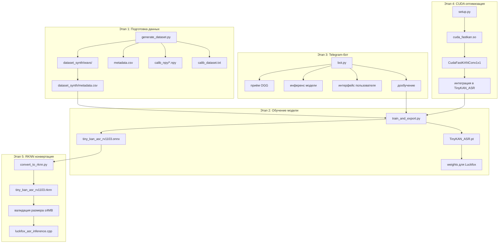

# План приведения проекта KAN-ASR в порядок

## Текущее состояние проекта

### ✅ Выполнено
- Распаковка всех архивов (KAN_ASR_Pipeline_Bundle, FastKAN_CUDA_Kernel, Whisper_CKA_Alignment, KAN_ASR_Docs_Markdown)
- Проверка наличия ключевых файлов
- Анализ технической документации

### ❌ Не выполнено
- Генерация синтетического датасета
- Обучение модели
- Тестирование CUDA ядер
- Разработка Telegram-бота
- Конвертация в RKNN

---

## Диаграмма структуры проекта

---

## Детальный план по этапам

### Этап 1: Подготовка данных и генерация синтетического корпуса

**Цель:** Сформировать сбалансированный обучающий и валидационный датасет для русского языка.

**Задачи:**
1. Проверка наличия Piper TTS и FFmpeg
2. Запуск `generate_dataset.py` для генерации 200-50000 записей
3. Валидация структуры `dataset_synth/`:
   - `wavs/` - WAV файлы (16 кГц, моно, 16-бит PCM)
   - `metadata.csv` - CSV с filename и text
4. Создание калибровочного набора `calib_npy/` (150 спектрограмм)
5. Создание `calib_dataset.txt` для RKNN конвертации

**Результат:** Готовый пайплайн загрузки данных и аугментаций, сгенерированный датасет на диске.

---

### Этап 2: Прототипирование модели на чистом PyTorch и базовое обучение

**Цель:** Обучить базовую акустическую модель `TinyKAN_ASR` (~1.2M параметров).

**Задачи:**
1. Проверка наличия `train_and_export.py`
2. Тестирование CUDA ядра (`FastKAN_CUDA_Kernel/test_and_benchmark.py`)
3. Запуск обучения модели на сгенерированных данных
4. Экспорт модели в ONNX формат (`tiny_kan_asr_rv1103.onnx`)
5. Валидация качества (WER/CER метрики)

**Результат:** Обученные веса модели (`tiny_kan_asr_base.pt`) и скрипт расчета метрик WER/CER.

---

### Этап 3: Telegram-бот для сбора данных и дообучения (Active Learning)

**Цель:** Запустить контур непрерывного улучшения модели на реальных голосовых сообщениях.

**Задачи:**
1. Проектирование архитектуры бота (asyncio + aiohttp)
2. Разработка модулей:
   - Приём `.ogg` сообщений
   - Инференс текущей модели
   - Интерфейс подтверждения/исправления текста
3. Реализация фоновой задачи дообучения (каждые 64-100 записей)
4. Тестирование бота

**Результат:** Работающий сервис сбора живой речи и автоматического дообучения.

---

### Этап 4: Оптимизация вычислений (Кастомные CUDA-ядра)

**Цель:** Ускорить обучение и инференс KAN-слоев на видеокартах NVIDIA.

**Задачи:**
1. Сборка CUDA расширения (`python setup.py install`)
2. Тестирование точности и производительности (`test_and_benchmark.py`)
3. Интеграция `CudaFastKANConv1x1` в модель `TinyKAN_ASR`
4. Замена стандартного `FastKANConv1x1` на оптимизированную версию

**Результат:** Ускорение обучения KAN-слоев на RTX 3060 и GTX 1050 Ti.

---

### Этап 5: Конвертация в RKNN и запуск на Luckfox Pico Plus (RV1103)

**Цель:** Портировать обученную модель на аппаратный NPU платы Luckfox Pico Plus.

**Задачи:**
1. Проверка наличия `rknn-toolkit2`
2. Конвертация ONNX в INT8 `.rknn` (`convert_to_rknn.py`)
3. Валидация размера `.rknn` файла (≤ 4 МБ)
4. Подготовка C++ приложения (`luckfox_asr_inference.cpp`)
5. Сборка под RV1103 с использованием Luckfox SDK

**Результат:** Автономное офлайн-распознавание речи на плате Luckfox Pico Plus в реальном времени.

---

## Сводная таблица этапов

| Этап | Основные инструменты | Используемое железо | Критерий готовности |
|------|---------------------|---------------------|---------------------|
| 1. Данные | Python, Piper TTS, ffmpeg, scipy | GTX 1050 Ti / CPU | Собрано ≥ 30 тыс. аудиозаписей + 150 `.npy` для калибровки |
| 2. Базовая модель | Чистый PyTorch (TinyKAN_ASR, CTCLoss) | RTX 3060 (bf16) | Модель сходится, размер весов позволяет уложиться в < 4 МБ в INT8 |
| 3. Бот дообучения | asyncio, aiohttp, ffmpeg | RTX 3060 | Бот принимает голос, сохраняет правки и обновляет веса при падении WER |
| 4. CUDA-ядра | C++, CUDA, cpp_extension | RTX 3060 / GTX 1050 Ti | Выходы и градиенты совпадают с PyTorch с точностью до 10⁻⁵ |
| 5. Портирование | ONNX, RKNN-Toolkit2, C++, librknnrt | ПК → Luckfox Pico Plus | Стабильный инференс на NPU RV1103 без выхода за лимит 64 МБ RAM |

---

## Порядок выполнения

1. **Этап 1** → Генерация данных (базис для обучения)
2. **Этап 2** → Обучение модели (использует данные из Этапа 1)
3. **Этап 4** → Оптимизация CUDA (параллельно с Этапом 2)
4. **Этап 3** → Разработка бота (может выполняться параллельно)
5. **Этап 5** → Конвертация в RKNN (требует модель из Этапа 2)

---

## Необходимые ресурсы

### Железо
- **RTX 3060** (12 ГБ VRAM) - основное обучение, бот
- **GTX 1050 Ti** (4 ГБ VRAM) - генерация данных, валидация
- **Luckfox Pico Plus** (RV1103) - целевая платформа для инференса

### ПО
- Python 3.10+
- PyTorch 2.0+ с CUDA support
- pip, rknn-toolkit2
- Luckfox SDK (для C++ сборки)

---

## Следующие шаги

1. Подтверждение плана пользователем
2. Начало выполнения Этапа 1 (генерация данных)
3. Параллельное выполнение Этапа 4 (CUDA оптимизация)
