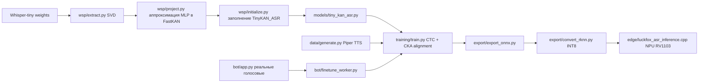

# План: нормальная структура каталогов и миграция проекта KAN-ASR

> **Статус:** согласован с пользователем. Принятые решения — в разделе 6.

## 1. Суть проекта (уточнено пользователем)

Проект — это **не обучение ASR с нуля**, а контур **Weight-Space Programming (WSP)**:

1. Взять предобученную модель (Whisper-tiny) как «учителя».
2. **Аналитически извлечь** из её весов полезные примитивы (SVD фильтров, функциональная аппроксимация MLP → Гауссианы FastKAN).
3. **Напрямую вычислить и заполнить** веса компактной KAN-модели `TinyKAN_ASR` (~1.2M параметров).
4. **Дообучить** («тюнить») на реальных данных, собираемых через Telegram-бота (Human-in-the-Loop).
5. Экспортировать в ONNX → RKNN (INT8) и запустить на NPU Luckfox Pico Plus (RV1103).

Следовательно, структура должна делать **WSP-контур первичным**, а не побочным модулем.

---

## 2. Проблемы текущей структуры

| # | Проблема | Последствие |
|---|----------|-------------|
| 1 | Нет пакетной структуры, код в «бандлах» | Плоские импорты `from standalone_whisper_teacher import ...` работают только из своей папки |
| 2 | Нет `pyproject.toml` / `requirements.txt` | Зависимости описаны только в `venv_setup_instructions.md` |
| 3 | `venv/` внутри проекта | Мусор в поиске/бэкапах, ломает изоляцию |
| 4 | Данные и артефакты вперемешку с кодом | `dataset_synth/`, `calib_npy/`, `*.onnx`, `*.wav` в корне |
| 5 | Жёстко зашитые относительные пути | `./piper/...`, `dataset_synth`, `calib_dataset.txt` — сломаются при переносе |
| 6 | Дубликаты `.zip` + распакованные каталоги | Непонятно, что источник истины |
| 7 | WSP-модуль распакован прямо в корень (`whisper_wsp_initializer.py`, `run_wsp_demo.py`, `README_WSP.md`) | Ядро проекта лежит в корне рядом с мусором |
| 8 | **`TinyKAN_ASR` продублирован в 3 местах** | `kan_asr_models.py`, `whisper_wsp_initializer.py`, `Whisper_CKA_Alignment/train_with_alignment.py` — рассинхронизация архитектуры |
| 9 | Нет тестов, нет единой точки входа, нет корневого README | Нельзя проверить корректность после миграции |

---

## 3. Целевая структура (src-layout)

```
voice-recognition/
├── pyproject.toml              # метаданные пакета, зависимости, entry points
├── requirements.txt            # runtime-зависимости (для быстрого pip install)
├── requirements-dev.txt        # pytest, ruff, mypy
├── .gitignore                  # venv/, data/, artifacts/, __pycache__/
├── README.md                   # обзор проекта и WSP-контура
├── Makefile                    # make data / wsp / train / export / test
│
├── configs/                    # YAML-конфиги (гиперпараметры, пути)
│   ├── model.yaml
│   ├── wsp.yaml
│   ├── train.yaml
│   └── bot.yaml
│
├── src/
│   └── kan_asr/
│       ├── __init__.py
│       ├── models/             # архитектуры
│       │   ├── kan_layers.py       # PureFastKANLayer, PureChebyKANLayer, NPUFriendlyMoEKAN, FastKANConv1x1
│       │   ├── tiny_kan_asr.py     # TinyKAN_ASR, DepthwiseSeparableConv1D_as_2D
│       │   ├── whisper_teacher.py  # WhisperTinyTeacher (автономный энкодер)
│       │   └── cuda_fastkan.py     # CudaFastKANConv1x1 (обёртка над CUDA-ядром)
│       ├── wsp/                # ЯДРО: Weight-Space Programming
│       │   ├── extract.py          # extract_conv_subspace (SVD + интерполяция 80→40)
│       │   ├── project.py          # project_mlp_to_fastkan (lstsq/Ridge → Гауссианы)
│       │   ├── initialize.py       # WhisperWeightSpaceProgrammer.initialize_student
│       │   └── hyper_adapter.py    # WeightSpaceHyperAdapter (низкоранговые Delta-W)
│       ├── data/               # данные и признаки
│       │   ├── vocab.py            # VOCAB, text_to_ids, greedy_ctc_decode
│       │   ├── mel.py              # PureMelSpectrogram
│       │   ├── augment.py          # шум, скорость, громкость, кодек
│       │   ├── generate.py         # генерация синтетики через Piper TTS
│       │   └── dataset.py          # Dataset / DataLoader
│       ├── training/           # обучение и метрики
│       │   ├── ctc.py              # CTC-декодер
│       │   ├── alignment.py        # linear_cka_loss, WhisperKANAlignmentLoss
│       │   ├── metrics.py          # WER / CER
│       │   └── train.py            # цикл обучения (bf16 / fp32)
│       ├── export/             # экспорт и квантование
│       │   ├── export_onnx.py      # PyTorch → ONNX (статический граф)
│       │   └── convert_rknn.py     # ONNX → RKNN INT8 (rv1103)
│       ├── bot/                # Telegram-бот (Active Learning)
│       │   ├── app.py              # asyncio + aiohttp, точка входа
│       │   ├── handlers.py         # приём .ogg, подтверждение/правка текста
│       │   └── finetune_worker.py  # фоновое дообучение (70% новых + 30% базы)
│       └── utils/
│           ├── paths.py            # единый резолвер путей (data/, artifacts/)
│           └── logging.py
│
├── csrc/                       # кастомное CUDA-расширение
│   ├── fastkan_kernel.cu
│   ├── bindings.cpp
│   └── setup.py
│
├── edge/                       # нативный инференс для Luckfox
│   ├── luckfox_asr_inference.cpp
│   ├── CMakeLists.txt
│   └── README.md
│
├── scripts/                    # CLI-точки входа (тонкие обёртки над src/)
│   ├── generate_dataset.py
│   ├── wsp_init.py
│   ├── train.py
│   ├── export_onnx.py
│   ├── convert_rknn.py
│   └── run_bot.py
│
├── data/                       # ДАННЫЕ (в .gitignore)
│   ├── raw/                    # открытые корпуса (Golos, Common Voice)
│   ├── synth/
│   │   ├── wavs/
│   │   └── metadata.csv
│   ├── calib/
│   │   ├── npy/
│   │   └── calib_dataset.txt
│   └── real/                   # данные из Telegram-бота
│
├── artifacts/                  # АРТЕФАКТЫ (в .gitignore)
│   ├── checkpoints/            # *.pt
│   ├── onnx/                   # tiny_kan_asr_rv1103.onnx
│   ├── rknn/                   # tiny_kan_asr_rv1103.rknn
│   └── piper/                  # ru_RU-irina-medium.onnx + .json
│
├── docs/
│   ├── TZ_KAN_ASR_Luckfox.md
│   ├── Plan_Razrabotki_KAN_ASR.md
│   ├── architecture.md         # описание WSP-контура
│   └── chats/
│       ├── chat1.md
│       └── chat2.md
│
├── tests/
│   ├── test_kan_layers.py
│   ├── test_wsp.py
│   ├── test_mel.py
│   └── test_ctc.py
│
└── plans/                      # планы (уже существует)
```

### Соответствие «старое → новое»

| Текущее расположение | Новое расположение |
|---|---|
| `kan_asr_models.py` | `src/kan_asr/models/kan_layers.py` + `tiny_kan_asr.py` |
| `KAN_ASR_Pipeline_Bundle/generate_dataset.py` | `src/kan_asr/data/generate.py` + `scripts/generate_dataset.py` |
| `KAN_ASR_Pipeline_Bundle/train_and_export.py` | `src/kan_asr/training/train.py` + `data/mel.py` + `data/vocab.py` + `export/export_onnx.py` |
| `KAN_ASR_Pipeline_Bundle/convert_to_rknn.py` | `src/kan_asr/export/convert_rknn.py` |
| `KAN_ASR_Pipeline_Bundle/luckfox_asr_inference.cpp` | `edge/luckfox_asr_inference.cpp` |
| `FastKAN_CUDA_Kernel/*` | `csrc/*` |
| `Whisper_CKA_Alignment/standalone_whisper_teacher.py` | `src/kan_asr/models/whisper_teacher.py` |
| `Whisper_CKA_Alignment/cka_feature_alignment.py` | `src/kan_asr/training/alignment.py` |
| `Whisper_CKA_Alignment/train_with_alignment.py` | `src/kan_asr/training/train.py` (слить) |
| `whisper_wsp_initializer.py` | `src/kan_asr/wsp/{extract,project,initialize,hyper_adapter}.py` |
| `run_wsp_demo.py` | `scripts/wsp_init.py` |
| `README_WSP.md` | `docs/wsp.md` |
| `test_piper_tts.py` | `tests/test_piper_tts.py` |
| `get_models.py` | `scripts/` (утилита) или удалить |
| `dataset_synth/` | `data/synth/` |
| `calib_npy/` + `calib_dataset.txt` | `data/calib/` |
| `piper/` | `artifacts/piper/` |
| `tiny_kan_asr_rv1103.onnx` | `artifacts/onnx/` |
| `test_audio_00*.wav` | `data/samples/` |
| `KAN_ASR_Docs_Markdown/*.md` | `docs/` |
| `chat1.md`, `chat2.md` | `docs/chats/` |
| `venv_setup_instructions.md` | `docs/setup.md` |
| `*.zip` (дубликаты) | удалить после проверки |
| `venv/` | удалить из проекта (пересоздать вне или в `.gitignore`) |

---

## 4. Диаграмма WSP-контура (целевой поток данных)



---

## 5. Фазы миграции

### Фаза 0. Подготовка и страховка
- **Git-репозиторий создаёт пользователь сам** (baseline-коммит всего текущего состояния НЕ делаем).
- Расширить `.gitignore` так, чтобы в репозиторий **не попадали**: архивы (`*.zip`), скачанные и обученные модели (`*.onnx`, `*.pt`, `*.rknn`, `*.bin`), сгенерированные датасеты (`data/`), `venv/`, `artifacts/`.
- Составить точную карту дубликатов `.zip` ↔ распакованные каталоги (для последующего переноса в `archive/`).
- WSP-модуль уже распакован в корень (`whisper_wsp_initializer.py`, `run_wsp_demo.py`, `README_WSP.md`) — учесть при переносе.

### Фаза 1. Каркас и инфраструктура
- Создать дерево каталогов (`src/kan_asr/...`, `csrc/`, `edge/`, `scripts/`, `data/`, `artifacts/`, `docs/`, `tests/`, `configs/`).
- Добавить `pyproject.toml` (src-layout, зависимости, entry points), `requirements.txt`, `requirements-dev.txt`.
- Добавить `.gitignore` (`venv/`, `data/`, `artifacts/`, `__pycache__/`, `*.zip`).
- Добавить корневой `README.md` и `Makefile`.

### Фаза 2. Перенос кода в пакет
- **Устранить дублирование `TinyKAN_ASR`:** выбрать `models/tiny_kan_asr.py` как единственный источник истины; `whisper_wsp_initializer.py` и `train_with_alignment.py` должны импортировать модель оттуда, а не переопределять.
- Разбить `kan_asr_models.py` на `models/kan_layers.py` и `models/tiny_kan_asr.py`.
- Перенести `Whisper_CKA_Alignment/*` в `models/whisper_teacher.py` и `training/alignment.py`.
- Разбить `train_and_export.py` на `data/mel.py`, `data/vocab.py`, `training/train.py`, `export/export_onnx.py`.
- Перенести `generate_dataset.py` → `data/generate.py` (+ `data/augment.py`).
- Перенести `convert_to_rknn.py` → `export/convert_rknn.py`.
- Перенести CUDA-код в `csrc/`, C++ раннер в `edge/`.
- Разложить `whisper_wsp_initializer.py` в `wsp/extract.py` (`extract_conv_subspace`), `wsp/project.py` (`project_mlp_to_fastkan`), `wsp/initialize.py` (`WhisperWeightSpaceProgrammer`), `wsp/hyper_adapter.py` (`WeightSpaceHyperAdapter`).
- Перенести `run_wsp_demo.py` → `scripts/wsp_init.py` (тонкая обёртка, скачивание весов Whisper-tiny).

### Фаза 3. Устранение жёстких путей и импортов
- Ввести `utils/paths.py` — единый резолвер путей к `data/` и `artifacts/` (через переменные окружения / конфиг).
- Заменить все относительные пути (`./piper/...`, `dataset_synth`, `calib_dataset.txt`) на вызовы резолвера.
- Заменить плоские импорты (`from standalone_whisper_teacher import ...`) на пакетные (`from kan_asr.models.whisper_teacher import ...`).
- Создать тонкие CLI-обёртки в `scripts/` (аргументы через `argparse`, вызов функций из `src/`).

### Фаза 4. Перенос данных и артефактов
- Переместить `dataset_synth/` → `data/synth/`, `calib_npy/` + `calib_dataset.txt` → `data/calib/`.
- Переместить `piper/` → `artifacts/piper/`, `tiny_kan_asr_rv1103.onnx` → `artifacts/onnx/`.
- Переместить `test_audio_00*.wav` → `data/samples/`.
- Обновить пути внутри `calib_dataset.txt` (относительно нового расположения).

### Фаза 5. Документация и очистка
- Переместить `KAN_ASR_Docs_Markdown/*.md` → `docs/`, `chat1.md`/`chat2.md` → `docs/chats/`.
- Переименовать `venv_setup_instructions.md` → `docs/setup.md`, обновить пути.
- Переместить все `.zip`-архивы в `archive/` (НЕ удалять — сохранить как историю).
- `venv/` оставить на месте, но он уже в `.gitignore` (в репозиторий не попадёт).
- `get_models.py` — пользователь удалит сам.

### Фаза 6. Верификация
- Установить пакет в editable-режиме (`pip install -e .`).
- Проверить импорты: `python -c "import kan_asr"`.
- Прогнать smoke-тесты: создание `TinyKAN_ASR`, прямой проход, экспорт ONNX.
- Добавить базовые тесты в `tests/` (формы тензоров, CTC-декодер, mel-спектрограмма).
- Проверить, что `scripts/*.py` запускаются из корня проекта.

---

## 6. Принятые решения (согласовано)

| # | Вопрос | Решение |
|---|--------|---------|
| 1 | Стиль структуры | **src-layout** (устанавливаемый пакет `src/kan_asr/`) |
| 2 | Судьба `venv/` | Оставить на месте, добавить в `.gitignore` |
| 3 | Судьба `.zip`-архивов | Сохранить в `archive/` (не удалять) |
| 4 | `get_models.py` | Пользователь удалит сам |
| 5 | Git-репозиторий | Пользователь создаёт сам; baseline-коммит всего состояния НЕ делаем |

### Что НЕ должно попасть в git-репозиторий
- Архивы: `*.zip`
- Скачанные и обученные модели: `*.onnx`, `*.pt`, `*.rknn`, `*.bin`, `*.onnx.json`
- Сгенерированные датасеты: `data/`
- Артефакты: `artifacts/`
- Виртуальное окружение: `venv/`
- Кэш Python: `__pycache__/`, `*.pyc`
