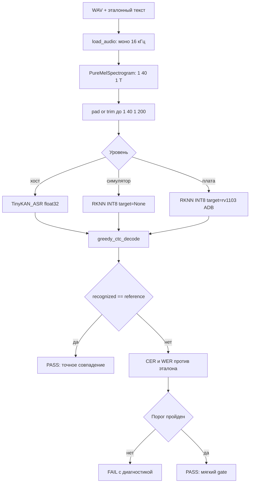
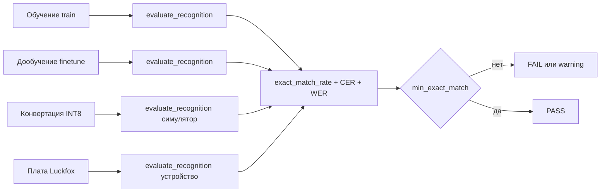

# Аудит и план: E2E-тесты распознавания звук → текст на хосте, в симуляторе NPU и на Luckfox

## 1. Аудит текущего покрытия

### 1.1. Что проверяется сегодня

| Уровень | Файл теста | Вход | Что реально проверяется |
|---|---|---|---|
| Хост PyTorch | [`tests/test_smoke.py`](../tests/test_smoke.py:68) | `torch.randn` | forward модели, формы тензоров |
| Хост PyTorch | [`tests/test_mel.py`](../tests/test_mel.py:17) | `torch.randn` | форма/конечность/фильтрбанк Mel |
| Хост CTC | [`tests/test_ctc.py`](../tests/test_ctc.py:19) | синтетические логиты | greedy-декод, CER/WER на строках |
| Симулятор NPU | [`tests/test_rknn_simulator.py`](../tests/test_rknn_simulator.py:111) | детерминированный **случайный** float | cosine similarity с ONNX, размер, память |
| Плата Luckfox | [`tests/test_rknn_benchmark.py`](../tests/test_rknn_benchmark.py:179) | **случайный** uint8 | latency/FPS/RTF, парсинг ADB |
| TTS (обратная задача) | [`tests/test_piper_tts.py`](../tests/test_piper_tts.py:33) | текст | синтез аудио |

### 1.2. Ключевые пробелы

1. **Нет ни одного теста «WAV → текст».** На всех уровнях используются случайные тензоры
   ([`_default_sample_input()`](../src/kan_asr/export/verify_rknn.py:315),
   [`_default_device_input()`](../src/kan_asr/export/verify_rknn.py:321)), а не реальное аудио.
2. **Нет функции распознавания WAV → текст.** Собранный пайплайн (`mel` → модель → `greedy_ctc_decode`)
   не обёрнут в единый хелпер. В боте
   ([`handle_voice()`](../src/kan_asr/bot/handlers.py:129)) распознанный текст приходит **извне**
   параметром `recognized_text` — то есть инференса там нет.
3. **Нет проверки качества распознавания (CER/WER) на реальных аудио.** Метрики
   [`cer()`](../src/kan_asr/training/metrics.py:26) / [`wer()`](../src/kan_asr/training/metrics.py:36)
   есть, но на аудио не применяются.
4. **Нет кросс-уровневой согласованности.** Не проверяется, что один и тот же WAV даёт
   согласованный результат на хосте (float32), в симуляторе (INT8) и на плате.
5. **Нативный раннер на плате не умеет распознавать звук.** В
   [`edge/luckfox_asr_inference.cpp`](../edge/luckfox_asr_inference.cpp:70) `mel_input`
   инициализирован нулями (`TODO`: ALSA → FFT → Mel), поэтому «полный» инференс на устройстве
   без хоста сейчас невозможен.

### 1.3. Что уже готово и переиспользуемо

- Признаки: [`PureMelSpectrogram`](../src/kan_asr/data/mel.py:13) — [B, Samples] → [B, 40, 1, T].
- Модель: [`TinyKAN_ASR`](../src/kan_asr/models/tiny_kan_asr.py) — вход [1, 40, 1, 200] (2 c, шаг 10 мс).
- Декод: [`greedy_ctc_decode()`](../src/kan_asr/data/vocab.py:17), словарь [`VOCAB`](../src/kan_asr/data/vocab.py:7).
- Метрики: [`cer()`](../src/kan_asr/training/metrics.py:26), [`wer()`](../src/kan_asr/training/metrics.py:36).
- Симулятор и плата: [`verify_rknn_simulator()`](../src/kan_asr/export/verify_rknn.py:651),
  [`benchmark_on_device()`](../src/kan_asr/export/verify_rknn.py:482),
  [`_adb_devices()`](../src/kan_asr/export/verify_rknn.py:369).
- Данные с эталонными текстами: [`data/synth/metadata.csv`](../data/synth/metadata.csv:1)
  (формат `filename|text`, ~200 записей) + [`data/synth/wavs/`](../data/synth).
- Отдельные аудио без разметки: [`data/samples/test_audio_001.wav`](../data/samples/test_audio_001.wav).
- Артефакты: чекпоинт (`artifacts/checkpoints/`), ONNX (`artifacts/onnx/`), RKNN (`artifacts/rknn/`) —
  на момент аудита **отсутствуют** (есть только `perf_report.json`), поэтому все новые тесты
  обязаны корректно скипаться.

### 1.4. Вывод аудита

**Тестов распознавания звук → текст нет ни на одном из трёх уровней.** Требуется создать
E2E-тесты WAV → текст на хосте, в симуляторе NPU и на плате Luckfox, с пропуском при
отсутствии чекпоинта/ONNX/калибровки/платы.

---

## 2. Цель

1. Ввести единый хелпер распознавания **WAV → текст** (хост / симулятор / плата).
2. Добавить E2E-тесты распознавания на трёх уровнях с единым набором эталонов (WAV + текст).
3. **Проверять точное совпадение: распознанный текст == эталонный текст тестовой фразы**
   (`recognized_text == reference_text`) — это главный, «жёсткий» тест распознавания.
4. Проверять не только факт инференса, но и качество: `CER`/`WER` по порогу (мягкий gate).
5. Проверять согласованность результата между уровнями (хост ↔ симулятор ↔ плата).
6. Не сломать `make test` в окружении без чекпоинта/тулчейна/платы — всё новое скипается.

---

## 3. Схема

Точное совпадение проверяется на каждом этапе пайплайна, а не только в тестах:

---

## 4. Ключевые решения

- **Единый хелпер инференса.** Новый модуль
  [`src/kan_asr/inference/recognize.py`](../src/kan_asr/inference/recognize.py) с функциями
  `load_audio()`, `audio_to_mel()`, `fit_mel_length()`, `recognize_torch()`,
  `recognize_rknn_simulator()`, `recognize_on_device()`. Причина: сейчас E2E-инференса
  нет вообще, а CLI, тесты и бот должны переиспользовать один код.
- **Единый набор эталонов.** Хелпер `load_recognition_cases(n)` читает
  [`data/synth/metadata.csv`](../data/synth/metadata.csv:1) и берёт первые N пар
  `wav + text`. Фиксированный seed/сортировка → детерминированность.
- **Статический вход 2 с.** Модель экспортируется с фиксированным `[1,40,1,200]`
  ([`export_onnx.py`](../src/kan_asr/export/export_onnx.py:18)), поэтому Mel паддится/обрезается
  до 200 кадров (`fit_mel_length`). Это осознанное ограничение фиксированного окна.
- **Метрики как gate, но с настраиваемым порогом.** Качество крошечной модели может быть низким,
  поэтому `CER`-порог задаётся через env (`KAN_ASR_RECOGNITION_MAX_CER`, по умолчанию мягкий)
  и через `pytest.mark`. Обязательный минимум — непустой выход; качественный порог — тюнингуемый.
- **Разделение «smoke» и «quality».** Smoke-тест (инференс проходит, выход непустой) работает
  даже на слабом чекпоинте; quality-тест (CER ≤ порог) — отдельная метка.
- **Пропуск вместо падения.** Все три уровня используют `pytest.skip` при отсутствии
  артефактов: нет чекпоинта → skip хоста; нет ONNX/калибровки/`rknn` → skip симулятора;
  нет `adb`/платы/`rknn` → skip платы.
- **Плата: mel считается на хосте, а не в C++.** В [`edge/luckfox_asr_inference.cpp`](../edge/luckfox_asr_inference.cpp:70)
  Mel ещё не реализован, поэтому на устройство подаётся Mel, посчитанный хостом. Полный
  on-device пайплайн (ALSA → FFT → Mel) — **вне рамок** этого плана, фиксируется как известное ограничение.
- **Согласованность уровней.** Отдельный тест сравнивает строку, полученную на хосте (float32),
  и в симуляторе (INT8): совпадение или `CER` между ними ≤ порога.
- **Точное совпадение как сквозной gate на всех этапах.** Один хелпер
  `evaluate_recognition(cases, recognize_fn)` возвращает `RecognitionReport`
  (`exact_match_rate`, `cer`, `wer`, per-case). Он вызывается после **обучения**,
  после **дообучения**, после **конвертации INT8** (симулятор) и на **плате**.
  Порог доли точных совпадений — env `KAN_ASR_MIN_EXACT_MATCH` (по умолчанию `0.0`:
  только отчёт; gate включается явно). Так «тестовая фраза == текст» проверяется
  не только в pytest, но и в самом пайплайне.
- **Held-out для честной оценки.** Обучение/дообучение оцениваются на детерминированном
  подмножестве, не участвовавшем в шаге (для synth — фиксированный «хвост» `metadata.csv`;
  для дообучения — новые real-сэмплы + базовые synth). Иначе exact-match на train-данных завышен.

---

## 5. Шаги

### Часть A. Хелпер распознавания WAV → текст

1. Создать пакет [`src/kan_asr/inference/`](../src/kan_asr/inference/) (`__init__.py` +
   [`recognize.py`](../src/kan_asr/inference/recognize.py)).
2. Реализовать `load_audio(path, target_sr=16000) -> np.ndarray`: чтение WAV через
   `scipy.io.wavfile` (как в [`ASRDataset`](../src/kan_asr/data/dataset.py:36)), приведение
   к моно и ресемплинг до 16 кГц (`scipy.signal.resample`, как в
   [`generate.py`](../src/kan_asr/data/generate.py:93)).
3. Реализовать `audio_to_mel(waveform) -> np.ndarray`: батч [1, Samples] →
   [`PureMelSpectrogram`](../src/kan_asr/data/mel.py:13) → [1, 40, 1, T].
4. Реализовать `fit_mel_length(mel, time_frames=200) -> np.ndarray`: паддинг нулями или
   обрезка до [1, 40, 1, 200] под статический вход модели.
5. Реализовать `load_recognition_cases(n, data_dir=None) -> list[RecognitionCase]`:
   чтение `metadata.csv`, детерминированный отбор N пар; `RecognitionCase = (wav_path, ref_text)`.
6. Реализовать `recognize_torch(wav_path, checkpoint_path, device="cpu") -> str`:
   загрузка [`TinyKAN_ASR`](../src/kan_asr/models/tiny_kan_asr.py), `eval()`, forward,
   [`greedy_ctc_decode()`](../src/kan_asr/data/vocab.py:17).
7. Реализовать `recognize_rknn_simulator(wav_path, onnx_model, rknn_model, calib_dataset) -> str`:
   Mel на хосте → сборка/загрузка `.rknn` → `init_runtime(target=None)` → `inference` →
   декод. Переиспользовать [`build_rknn_model()`](../src/kan_asr/export/convert_rknn.py:12).
8. Реализовать `recognize_on_device(wav_path, rknn_model, target, device_id) -> DeviceRecognitionResult`
   (текст + latency): Mel на хосте → `init_runtime(target, device_id)` → `inference` → декод;
   подъём `rknn_server` — переиспользовать хелперы
   ([`_ensure_device()`](../src/kan_asr/export/verify_rknn.py:391),
   [`_check_rknn_server()`](../src/kan_asr/export/verify_rknn.py:423),
   [`_start_rknn_server()`](../src/kan_asr/export/verify_rknn.py:439)).
9. Добавить CLI `scripts/recognize.py`: `--wav` или `--cases N`, `--device {host,simulator,rv1103}`,
   `--checkpoint`, `--onnx`, `--rknn`, `--calib-file`, `--max-cer`; код возврата `0/1/2`
   (как в [`scripts/verify_rknn.py`](../scripts/verify_rknn.py:216)).

### Часть B. Тесты по уровням

10. `tests/test_recognize_host.py` — хост (PyTorch):
    - smoke: инференс по `data/synth` даёт непустую строку;
    - quality: `CER` ≤ порога (env `KAN_ASR_RECOGNITION_MAX_CER`);
    - skip, если нет чекпоинта в `artifacts/checkpoints/` или нет `metadata.csv`.
11. `tests/test_recognize_simulator.py` — симулятор NPU:
    - `pytest.importorskip("rknn")`; skip без ONNX/калибровки;
    - распознавание WAV через `recognize_rknn_simulator`;
    - согласованность с хостом: `CER(host_text, sim_text) ≤ порог`.
12. `tests/test_recognize_device.py` — плата Luckfox:
    - `pytest.importorskip("rknn")` + skip без `adb`/платы (по
      [`_adb_devices()`](../src/kan_asr/export/verify_rknn.py:369));
    - распознавание WAV через `recognize_on_device`; smoke + latency > 0;
    - метка `hardware`, чтобы исключалась из обычного прогона (`-m "not hardware"`).
13. Общий фикстур-модуль `tests/conftest.py` (или `tests/_recognition_cases.py`): пути через
    [`resolver`](../src/kan_asr/utils/paths.py:120), выбор N кейсов, регистрация меток
    `recognition` и `hardware` в `pytest.ini`/`pyproject.toml`.

### Часть C. Интеграция и документация

14. `Makefile`: цели `recognize-host`, `recognize-sim`, `recognize-board`
    (по аналогии с [`verify-rknn`](../Makefile:46) / [`bench-rknn`](../Makefile:50)).
15. `pyproject.toml`: зарегистрировать скрипт `recognize` в `[project.scripts]`
    (рядом с [`verify-rknn`](../pyproject.toml:62)); при необходимости — метки pytest.
16. Документация: [`docs/setup.md`](../docs/setup.md:104) — раздел «Тесты распознавания WAV → текст»
    (хост/симулятор/плата, пороги, коды возврата); [`docs/pipeline_bundle.md`](../docs/pipeline_bundle.md:36)
    и [`edge/README.md`](../edge/README.md:36) — ссылки; [`docs/architecture.md`](../docs/architecture.md:26) —
    новый модуль `inference/` в таблице структуры.

### Часть D. Точные совпадения на этапах пайплайна

17. Хелпер `evaluate_recognition(cases, recognize_fn, max_cer=None, min_exact_match=None)
    -> RecognitionReport` в [`recognize.py`](../src/kan_asr/inference/recognize.py):
    прогоняет кейсы, считает `exact_match_rate` (строка == эталон), `cer`, `wer`,
    per-case детали; методы `to_dict()` / `summary()` (по образцу
    [`PerformanceResult`](../src/kan_asr/export/verify_rknn.py:53)).
18. **Обучение.** В [`train()`](../src/kan_asr/training/train.py:86) добавить параметры
    `eval_cases: int = 0`, `eval_after_train: bool = False`, `min_exact_match: float = 0.0`:
    после эпох прогнать `evaluate_recognition` на детерминированном held-out подмножестве
    `data/synth` (фиксированный «хвост» `metadata.csv`), залогировать `exact_match_rate`/`CER`,
    сохранить `artifacts/reports/train_recognition.json`. При `min_exact_match > 0` — gate
    (предупреждение или исключение).
19. **Дообучение.** В [`run_finetune()`](../src/kan_asr/bot/finetune_worker.py:93) после
    дообучения прогнать `evaluate_recognition` на новых (real) сэмплах и на базовых synth;
    сравнить `exact_match_rate` до/после (baseline из `best.pt`) и залогировать регрессию —
    это явная защита от катастрофического забывания. Сохранить
    `artifacts/reports/finetune_recognition.json`.
20. **Конвертация INT8.** В [`convert_onnx_to_rknn()`](../src/kan_asr/export/convert_rknn.py:44)
    (или отдельной `verify_recognition_after_convert`) после сборки `.rknn` прогнать
    `evaluate_recognition` в симуляторе на реальных WAV и сравнить с хостом (float32):
    `exact_match_rate` и дельта `CER`. Дополняет текущую проверку на случайных тензорах
    ([`verify_rknn_simulator()`](../src/kan_asr/export/verify_rknn.py:651)) реальным аудио.
21. **Плата.** `recognize_on_device` + тест `test_recognize_device.py` проверяют exact-match
    на устройстве; CLI `scripts/recognize.py` получает `--min-exact-match` для gate.

### Часть E. Финальная проверка

22. Прогнать `ruff`, `mypy`, `pytest tests/ -v` без артефактов (всё новое скипается),
    затем — с чекпоинтом (хост) и, при наличии платы, `make recognize-board`.

---

## 6. Затрагиваемые файлы

| Файл | Действие |
|---|---|
| `src/kan_asr/inference/__init__.py` | создать |
| `src/kan_asr/inference/recognize.py` | создать: load_audio, audio_to_mel, fit_mel_length, recognize_torch, recognize_rknn_simulator, recognize_on_device, load_recognition_cases, evaluate_recognition, RecognitionReport |
| `scripts/recognize.py` | создать: CLI хост/симулятор/плата, `--min-exact-match` |
| `tests/test_recognize_host.py` | создать: E2E хост + exact-match + CER |
| `tests/test_recognize_simulator.py` | создать: E2E симулятор + согласованность с хостом |
| `tests/test_recognize_device.py` | создать: E2E плата + exact-match + latency, метка `hardware` |
| `tests/conftest.py` | создать: фикстуры/метки, выбор кейсов |
| `src/kan_asr/training/train.py` | добавить eval после обучения (exact-match/CER, отчёт) |
| `src/kan_asr/bot/finetune_worker.py` | добавить eval после дообучения (регрессия exact-match) |
| `src/kan_asr/export/convert_rknn.py` | добавить eval распознавания после конвертации INT8 |
| `src/kan_asr/export/verify_rknn.py` | переиспользовать/дополнить аудио-проверкой |
| `artifacts/reports/` | создать: train/finetune/simulator recognition-отчёты |
| `Makefile` | цели `recognize-host`, `recognize-sim`, `recognize-board` |
| `pyproject.toml` | скрипт `recognize`, метки pytest |
| `docs/setup.md` | раздел про тесты распознавания |
| `docs/pipeline_bundle.md` | шаг E2E-распознавания |
| `edge/README.md` | ограничение: mel на хосте, TODO в C++ |
| `docs/architecture.md` | модуль `inference/` в структуре |

---

## 7. Риски и как их снимаем

- **Качество крошечной модели низкое → строгий CER валит тест.** Порог выносим в env
  (`KAN_ASR_RECOGNITION_MAX_CER`) + разделяем smoke (непустой выход) и quality (CER). По умолчанию
  quality-тест можно помечать `skip`, если чекпоинт не обучен (`KAN_ASR_STRICT_RECOGNITION=1` включает gate).
- **Синтетические WAV — заглушки-тоны.** Если Piper не установлен,
  [`generate.py`](../src/kan_asr/data/generate.py:95) пишет модулированный тон без речи — распознавать
  нечего. Митигируем: тест проверяет, что WAV реальный речевой (по наличию Piper-модели) либо
  понижает ожидания до smoke; фиксируем в README тестов.
- **Разный dtype входа на устройстве (uint8 vs float32).** Симулятор принимает float32,
  устройство может требовать uint8. Митигируем: в `recognize_on_device` параметр `input_dtype`
  и попытка float32 (тулчейн квантует сам), при ошибке — явное сообщение; уточняем по факту на плате.
- **Mel на хосте ≠ Mel на устройстве в будущем.** Сейчас согласовано (оба через
  [`PureMelSpectrogram`](../src/kan_asr/data/mel.py:13)); когда появится C++-Mel, добавим тест
  согласованности C++ Mel ↔ Python Mel.
- **Долгий/нестабильный ADB.** Тест платы помечаем `hardware` и исключаем из `make test`;
  в CI без платы — всегда skip.
- **Фиксированное окно 2 с.** Более длинные фразы обрезаются — тест выбирает короткие кейсы
  и/или допускает обрезку; ограничение документируем.

---

## 8. Критерии готовности

1. `python scripts/recognize.py --device host --cases 5` печатает распознанный текст,
   exact-match и CER.
2. `pytest tests/test_recognize_host.py -v` проходит при наличии чекпоинта и скипается без него.
3. `pytest tests/test_recognize_simulator.py -v` проходит при наличии `rknn`+ONNX+калибровки,
   проверяет согласованность с хостом, скипается иначе.
4. `pytest tests/test_recognize_device.py -v` проходит при подключённой плате, скипается иначе.
5. После `train()` в логе есть `exact_match_rate`/`CER` и создан
   `artifacts/reports/train_recognition.json`.
6. После `run_finetune()` залогирована дельта `exact_match_rate` до/после и создан
   `artifacts/reports/finetune_recognition.json`.
7. После `convert_onnx_to_rknn()` есть отчёт распознавания в симуляторе на реальных WAV
   и сравнение с хостом (exact-match, дельта CER).
8. `make test` без артефактов — зелёный (все новые тесты скипаются).
9. `ruff` и `mypy` без ошибок на новых файлах.
10. Документация обновлена, ограничение C++-раннера зафиксировано.
