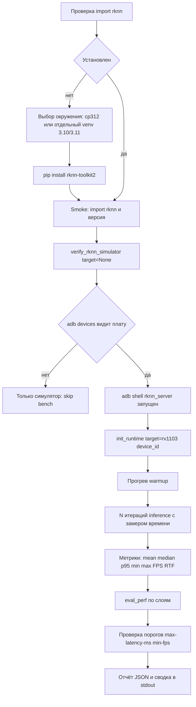

# План: установка rknn-toolkit2 и оценка производительности на подключённой плате (USB/ADB)

## Контекст

### Что уже есть

- [`src/kan_asr/export/verify_rknn.py`](../src/kan_asr/export/verify_rknn.py:184) —
  `verify_rknn_simulator()`: сборка `.rknn` INT8, `init_runtime(target=None)`,
  `inference`, сравнение с ONNX Runtime (cosine / max abs diff), лимиты
  размера (4 МБ) и памяти (64 МБ), опционально `accuracy_analysis`.
- [`scripts/verify_rknn.py`](../scripts/verify_rknn.py:28) — CLI с флагами
  `--onnx`, `--rknn`, `--calib-file`, `--min-cosine`, `--max-size-mb`,
  `--max-memory-mb`, `--accuracy-analysis`, `--rebuild`, `--data-format`.
- [`tests/test_rknn_simulator.py`](../tests/test_rknn_simulator.py:30) —
  `pytest.importorskip("rknn")`, полный прогон в симуляторе.
- [`pyproject.toml`](../pyproject.toml:46) — extras `rknn = ["rknn-toolkit2>=1.5"]`,
  скрипт `verify-rknn`; [`Makefile`](../Makefile:44) — цель `verify-rknn`.
- Документация: [`docs/setup.md`](../docs/setup.md:98),
  [`docs/pipeline_bundle.md`](../docs/pipeline_bundle.md:36),
  [`edge/README.md`](../edge/README.md:36).

### Чего нет

1. **`rknn-toolkit2` не установлен в venv проекта.** В
   `venv/lib/python3.12/site-packages` пакета `rknn` нет (есть `onnx`,
   `onnxruntime`, `fast_histogram`, `psutil`, `ruamel`, `cv2`, `tqdm`,
   `protobuf 4.25.4` — то есть почти все зависимости тулчейна уже стоят).
   venv создан на **Python 3.12.3** ([`venv/pyvenv.cfg`](../venv/pyvenv.cfg:3)),
   а официальные x86_64-колёса `rknn-toolkit2` собираются под ограниченный
   набор версий CPython — совместимость с cp312 нужно проверить фактически.
2. **Нет оценки производительности на реальном NPU.** В
   [`docs/chats/chat4.md`](../docs/chats/chat4.md:16) зафиксировано требование:
   подключить плату по USB/ADB и вызвать `init_runtime(target='rv1103')`,
   чтобы замеры задержки/FPS шли на аппаратном NPU. В коде этого нет:
   `target` жёстко `None`, нет `device_id`, нет замеров времени, нет
   `eval_perf()`, нет проверки доступности `adb`.

## Цель

1. Проверить наличие `rknn-toolkit2` и установить его, если отсутствует
   (с работоспособным окружением под поддерживаемую версию Python).
2. Добавить режим оценки производительности на подключённой по USB/ADB плате:
   `init_runtime(target='rv1103', device_id=...)`, прогрев, N итераций,
   метрики latency/FPS/RTF, `eval_perf()` по слоям, JSON-отчёт.
3. Не сломать существующий сценарий симулятора и `make test` в окружении
   без тулчейна и без платы.

## Схема

## Ключевые решения

- **Единый модуль, два режима.** Расширяем
  [`src/kan_asr/export/verify_rknn.py`](../src/kan_asr/export/verify_rknn.py:184)
  параметрами `target: str | None` и `device_id: str | None`, а не создаём
  второй скрипт: точность, размер и память проверяются одинаково в обоих режимах.
- **Отдельный dataclass `PerformanceResult`** (latency mean/median/p95/min/max,
  fps, rtf, warmup, iterations, per-layer отчёт `eval_perf`, device_id) —
  чтобы `VerificationResult` не разрастался, а JSON-отчёт был стабильным.
- **RTF как основная метрика для ASR.** Окно входа — 2 с аудио
  (`[1, 40, 1, 200]`, шаг 10 мс), поэтому `rtf = latency_s / 2.0`;
  RTF < 1 означает работу быстрее реального времени.
- **Проверка ADB до инициализации рантайма.** `adb devices` через
  `subprocess` (без сторонних зависимостей), понятная ошибка, если плата
  не видна или `rknn_server` не запущен на устройстве.
- **Пороговые проверки опциональны.** `--max-latency-ms` и `--min-fps`
  по умолчанию `None` (не валят прогон), чтобы бенчмарк можно было запускать
  как измерение, а не только как gate.
- **Совместимость.** Всё новое — за ленивым импортом `rknn` и `shutil.which("adb")`;
  без тулчейна/платы тесты скипаются, `make test` остаётся зелёным.

## Шаги

### Часть A. Проверка и установка rknn-toolkit2

1. Проверить фактическое состояние окружения:
   `./venv/bin/python -c "import rknn, sys; print(rknn.__file__)"`,
   `./venv/bin/pip show rknn-toolkit2`, `./venv/bin/python -V`,
   `./venv/bin/pip list | grep -Ei "numpy|onnx|protobuf|fast-histogram|ruamel|psutil"`.
2. Определить совместимость: есть ли wheel `rknn-toolkit2` под CPython 3.12
   (проверить имена файлов в `packages/x86_64` официального репозитория
   `airockchip/rknn-toolkit2`). Если cp312-колеса нет — создать отдельный
   venv на поддерживаемой версии (3.10/3.11) и установить туда, не ломая
   основной venv проекта.
3. Установить пакет: `pip install rknn-toolkit2` (или конкретный `.whl`
   из репозитория) + при необходимости зафиксировать совместимые
   `numpy<2` / `protobuf` в отдельном requirements-файле для rknn-окружения.
4. Smoke-проверка: `python -c "from rknn.api import RKNN; print('rknn OK')"`,
   зафиксировать версию тулчейна в отчёте/доке.
5. Зафиксировать в документации, какое окружение рабочее (основной venv или
   отдельный), и как его активировать — чтобы `make verify-rknn` не запускался
   «не тем» интерпретатором.

### Часть B. Оценка производительности на плате по USB/ADB

6. Добавить в [`src/kan_asr/export/verify_rknn.py`](../src/kan_asr/export/verify_rknn.py:184)
   вспомогательные функции: `_import_adb()` / `_adb_devices()` (парсинг
   `adb devices`), `_ensure_device(device_id)` с понятными ошибками
   («плата не найдена», «несколько устройств — укажите --device-id»),
   `_check_rknn_server(device_id)` (`adb shell pidof rknn_server`).
7. Добавить `PerformanceResult` и функцию `benchmark_on_device(...)`:
   `init_runtime(target="rv1103", device_id=...)` → `warmup` прогонов →
   `iterations` прогонов с `time.perf_counter()` → статистика
   (mean/median/p95/min/max, fps, rtf) → `eval_perf()` (per-layer, если
   доступен) → `release()`.
8. Расширить `verify_rknn_simulator(...)` параметрами `target`, `device_id`,
   `warmup`, `iterations`, `max_latency_ms`, `min_fps`, `perf_report_path`;
   при `target is not None` — вызывать бенчмарк и добавлять его результат
   в `VerificationResult` (поле `performance`), не меняя поведение при
   `target=None`.
9. Сохранять JSON-отчёт (`artifacts/rknn/perf_report.json` по умолчанию):
   версия тулчейна, target, device_id, форма входа, метрики, пороги, verdict.
10. Расширить CLI [`scripts/verify_rknn.py`](../scripts/verify_rknn.py:28):
    `--target {simulator,rv1103}`, `--device-id`, `--warmup`, `--iterations`,
    `--max-latency-ms`, `--min-fps`, `--perf-report`, `--list-devices`
    (печать `adb devices` и выход). Код возврата: 0 — проверки пройдены,
    1 — провал порогов, 2 — нет окружения/платы.
11. Добавить цель `bench-rknn` в [`Makefile`](../Makefile:44)
    (`$(PYTHON) scripts/verify_rknn.py --target rv1103 --iterations 50`)
    и, при необходимости, `adb-devices` для быстрой диагностики.

### Часть C. Тесты и документация

12. Добавить в [`tests/test_rknn_simulator.py`](../tests/test_rknn_simulator.py:100)
    unit-тесты без платы: расчёт статистики latency (mean/median/p95/fps/rtf)
    на синтетическом списке времён, парсинг `adb devices`, поведение при
    отсутствии `adb` (skip/ошибка), сериализация JSON-отчёта.
13. Добавить integration-тест бенчмарка с `pytest.mark.skipif` по
    `shutil.which("adb") is None` и по отсутствию устройства в `adb devices`.
14. Обновить документацию: [`docs/setup.md`](../docs/setup.md:98) — раздел
    «Оценка производительности на подключённой плате» (USB/ADB, `rknn_server`,
    флаги, интерпретация RTF/FPS); [`edge/README.md`](../edge/README.md:36) —
    ссылка на бенчмарк перед прошивкой; [`docs/pipeline_bundle.md`](../docs/pipeline_bundle.md:36) —
    шаг 5 «замер на железе».
15. Прогнать `ruff`, `mypy`, `pytest tests/ -v` в окружении без платы
    (всё новое должно скипаться) и, при наличии платы, — реальный
    `make bench-rknn`.

## Затрагиваемые файлы

| Файл | Действие |
|---|---|
| `src/kan_asr/export/verify_rknn.py` | расширить: `target`, `device_id`, `PerformanceResult`, `benchmark_on_device`, ADB-хелперы, JSON-отчёт |
| `scripts/verify_rknn.py` | новые флаги `--target`, `--device-id`, `--warmup`, `--iterations`, `--max-latency-ms`, `--min-fps`, `--perf-report`, `--list-devices` |
| `tests/test_rknn_simulator.py` | unit-тесты статистики/парсинга ADB + integration-тест с skip |
| `Makefile` | цели `bench-rknn`, `adb-devices` |
| `pyproject.toml` | при необходимости — extras/requirements для rknn-окружения |
| `requirements-optional.txt` | уточнить версию/ограничения `rknn-toolkit2` и `numpy` |
| `docs/setup.md` | раздел про установку тулчейна и бенчмарк на плате |
| `docs/pipeline_bundle.md` | шаг замера на железе |
| `edge/README.md` | ссылка на бенчмарк перед прошивкой |

## Риски и как их снимаем

- **Нет wheel под Python 3.12** → отдельный venv 3.10/3.11 или Docker-образ;
  основной venv проекта не трогаем.
- **`rknn_server` не запущен на плате** → явная проверка `pidof rknn_server`
  и подсказка в ошибке (`adb push`/`adb shell` запуск из SDK).
- **Несколько устройств в `adb devices`** → обязательный `--device-id`,
  иначе понятная ошибка вместо случайного выбора.
- **Шумные замеры по USB** → прогрев, N итераций, отчёт median/p95, а не
  только mean; пороги по умолчанию выключены.
- **Регресс симулятора** → `target=None` остаётся путём по умолчанию,
  существующий тест не меняет ожиданий.
