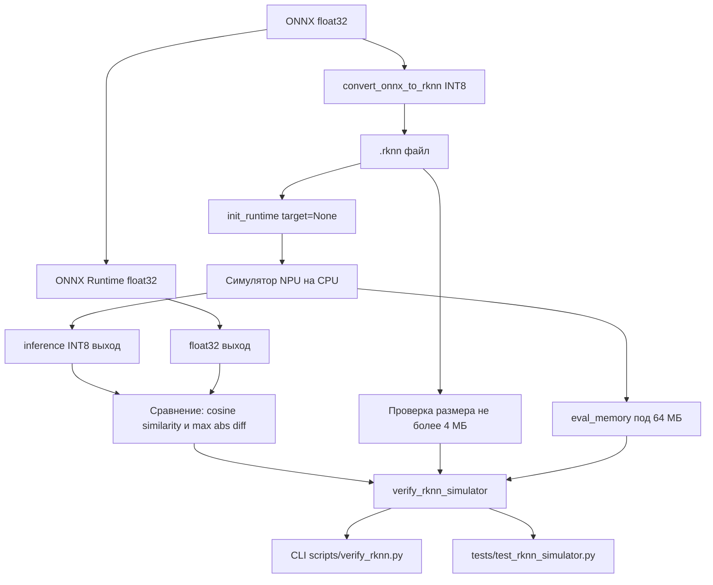

# План: проверка результата в симуляторе NPU на рабочем ПК

## Контекст

В проекте **отсутствует** проверка результата в симуляторе NPU на рабочем ПК.

Единственный код, работающий с RKNN, — [`convert_onnx_to_rknn()`](../src/kan_asr/export/convert_rknn.py:12).
Он выполняет только `load_onnx` → `build(do_quantization=True)` → `export_rknn` и на этом
останавливается. Отсутствуют вызовы симулятора:

- `rknn.init_runtime(target=None)` — инициализация эмулятора NPU на CPU;
- `rknn.inference(inputs=[...])` — прогон входа через эмулятор;
- `rknn.accuracy_analysis(...)` — сравнение float32 (ONNX) vs INT8 (эмулятор NPU);
- `rknn.eval_memory()` — оценка памяти под лимит 64 МБ.

В каталоге [`tests/`](../tests) нет ни одного RKNN-теста.

Требование зафиксировано в документации, но не реализовано:

- [`Plan_Razrabotki_KAN_ASR.md`](../docs/KAN_ASR_Docs_Markdown/Plan_Razrabotki_KAN_ASR.md:60) —
  «Проверить точность квантованной модели в симуляторе RKNN и убедиться, что размер файла ≤ 4 МБ»;
- [`docs/chats/chat4.md`](../docs/chats/chat4.md:116) — описан `rknn.accuracy_analysis()` и
  `eval_memory()`, но в коде их нет.

## Цель

Добавить полную проверку результата в симуляторе NPU на рабочем ПК:

1. Конвертация ONNX → RKNN INT8.
2. `init_runtime(target=None)` — эмулятор NPU на CPU.
3. `inference` в эмуляторе.
4. Сравнение с ONNX Runtime по косинусному сходству.
5. Проверка размера `.rknn` ≤ 4 МБ.
6. `eval_memory()` под лимит 64 МБ RAM платы RV1103.
7. Пропуск через `pytest.importorskip`, если `rknn-toolkit2` не установлен.
8. Отдельный CLI для ручного запуска.

## Схема

## Ключевые решения

- **Модуль** [`src/kan_asr/export/verify_rknn.py`](../src/kan_asr/export/verify_rknn.py) —
  единая функция `verify_rknn_simulator(...)`, переиспользуемая и CLI, и тестом.
  Ленивый им��орт `rknn.api.RKNN` (как в [`convert_rknn.py`](../src/kan_asr/export/convert_rknn.py:22)).
- **Сравнение точности** — один и тот же вход через ONNX Runtime (float32) и через эмулятор
  NPU (INT8), метрики: косинусное сходство и max abs diff по выходу `ctc_logits`.
- **Лимиты** — размер `.rknn` ≤ 4 МБ и `eval_memory()` под 64 МБ RAM платы RV1103.
- **CLI** [`scripts/verify_rknn.py`](../scripts/verify_rknn.py) + регистрация `verify-rknn`
  в [`pyproject.toml`](../pyproject.toml:57) и цель в [`Makefile`](../Makefile:9).
- **Тест** [`tests/test_rknn_simulator.py`](../tests/test_rknn_simulator.py) —
  `pytest.importorskip("rknn")`, чтобы `make test` не падал без `rknn-toolkit2`;
  при отсутствии калибровки/чекпоинта — `skip` с понятным сообщением.

## Шаги

1. Создать модуль верификации `src/kan_asr/export/verify_rknn.py` с функцией
   `verify_rknn_simulator(...)`: ленивый импорт `rknn.api.RKNN`, `init_runtime(target=None)`
   (эмулятор NPU на CPU), `inference(inputs=[...])`, `accuracy_analysis(...)`, `eval_memory()`,
   возврат структуры с метриками (cosine similarity, max abs diff, размер `.rknn`, память).
2. Реализовать в модуле сравнение выходов: прогон одного и того же входа через ONNX Runtime
   (float32) и через эмулятор NPU (INT8), расчёт косинусного сходства и max abs diff по выходу
   `ctc_logits`.
3. Добавить проверки лимитов: размер `.rknn` ≤ 4 МБ и пиковая память (`eval_memory`) под лимит
   64 МБ RAM платы RV1103.
4. Создать CLI-скрипт `scripts/verify_rknn.py` (argparse: `--onnx`, `--rknn`, `--calib-file`,
   `--input-shape`, `--min-cosine`, `--max-size-mb`, `--accuracy-analysis`) для ручного запуска
   проверки точности и памяти.
5. Зарегистрировать CLI-команду `verify-rknn` в `pyproject.toml` (`[project.scripts]`) и добавить
   цель `verify-rknn` в `Makefile`.
6. Создать тест `tests/test_rknn_simulator.py`: `pytest.importorskip("rknn")` для пропуска без
   `rknn-toolkit2`; экспорт ONNX (или готовый артефакт) → конвертация в RKNN INT8 →
   `init_runtime(target=None)` �� `inference` → сравнение с ONNX Runtime по косинусному сходству →
   проверка размера ≤ 4 МБ и `eval_memory` под 64 МБ.
7. Обеспечить корректный пропуск теста при отсутствии калибровочного датасета/чекпоинта
   (`skip` с понятным сообщением), чтобы `make test` не падал в обычном окружении.
8. Обновить документацию: `docs/setup.md` (проверка в симуляторе NPU),
   `docs/pipeline_bundle.md` (шаг верификации после конвертации), `edge/README.md`
   (ссылка на проверку точности INT8).
9. Проверить, что `make test` проходит без `rknn-toolkit2` (тест скипается) и что `ruff`/`mypy`
   не ругаются на новые файлы.

## Затрагиваемые файлы

| Файл | Действие |
|---|---|
| `src/kan_asr/export/verify_rknn.py` | создать |
| `scripts/verify_rknn.py` | создать |
| `tests/test_rknn_simulator.py` | создать |
| `pyproject.toml` | добавить `verify-rknn` в `[project.scripts]` |
| `Makefile` | добавить цель `verify-rknn` |
| `docs/setup.md` | дополнить разделом проверки в симуляторе |
| `docs/pipeline_bundle.md` | добавить шаг верификации |
| `edge/README.md` | добавить ссылку на проверку точности INT8 |
